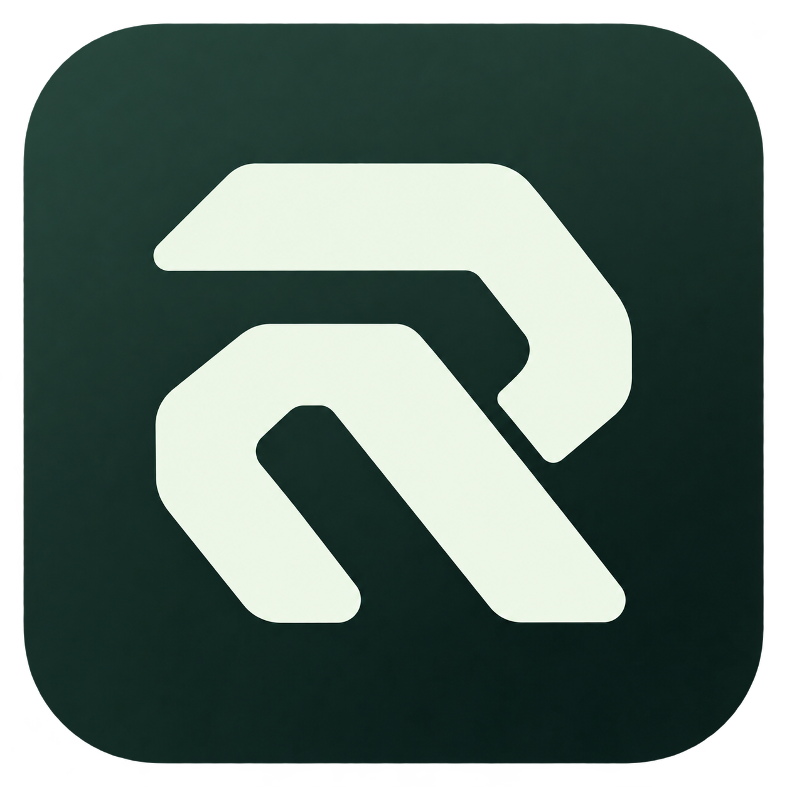
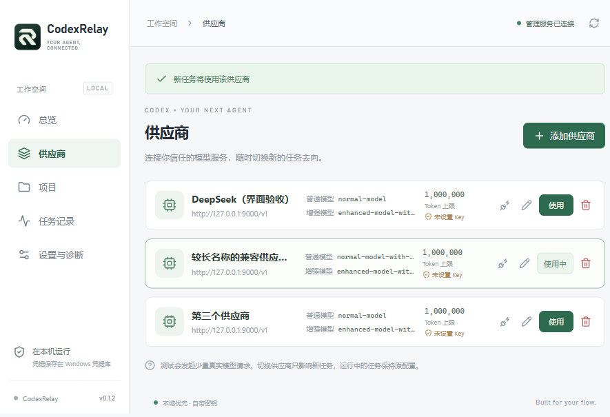

<div align="center">


# CodexRelay

**让 Codex 调用 DeepSeek，把子代理交给一个开关管理。**

[](https://github.com/Favio8/codexrelay/releases/tag/v0.4.1)
[](https://github.com/Favio8/codexrelay/releases/tag/v0.4.1)
[](LICENSE)
[](https://github.com/Favio8/codexrelay/actions/workflows/ci.yml)

简体中文 · [English](README_EN.md) · [下载安装](https://github.com/Favio8/codexrelay/releases/tag/v0.4.1) · [反馈问题](https://github.com/Favio8/codexrelay/issues)
</div>

**0.4.1 Windows Beta** 修复供应商保存、分层连接验证、接入修复、验收与续作门禁及日志计量；评测界面补齐 Pro、参考价格和失败结局登记。见 [发布记录](docs/RELEASE-0.4.1.md)、[27 项验收矩阵](docs/DELEGATION-ACCEPTANCE.md) 与 [评测操作说明](docs/DELEGATION-EXPERIMENTS.md)。真实客户端六场景和付费模型对照尚未执行，不宣称实际节省率。

## 为什么做 CodexRelay？

Codex 负责规划、判断和验收；DeepSeek 或 OpenAI 兼容模型可以执行独立的读取、分析、编码和测试任务。CodexRelay 把供应商配置、接入、开关与任务状态放进一个 Windows 桌面应用，免去手工维护运行环境和 MCP 配置。

安装、填入 Key、选择模型，然后开启。Codex 的主模型和登录继续由 Codex 管理。

## 界面预览



*真实 Windows 桌面界面，使用演示供应商数据。默认窗口 900 × 600，可缩放。*

## 下载与安装

**[下载 Windows x64 安装包（v0.4.1 Beta）](https://github.com/Favio8/codexrelay/releases/download/v0.4.1/CodexRelay_0.4.1_x64-setup.exe)**

[Release 说明与 SHA256 校验文件](https://github.com/Favio8/codexrelay/releases/tag/v0.4.1)

当前发布版本为 **0.4.1 Beta**。原引擎与 Pi 延续独立预算、checkpoint 和核验后剩余事项续作；新增接入诊断、选择性修复和受控评测。升级后在「设置与诊断」检查接入、预览所需能力与规则变更，应用后重新连接 Codex 验证当前聊天。配置写入不代表客户端已加载全部能力。详见 [发布记录](docs/RELEASE-0.4.1.md)。

- 当前优先支持 Windows；已在 Windows 11 x64 验证。界面为简体中文。
- 需要已有 Codex Desktop；同一 MCP 接入可用于 Codex CLI。
- 安装包自带 Python 与 Pi 所需的 Node 运行时，用户无需安装 Python、Git、Node.js 或 Rust。
- 使用 Windows WebView2；系统缺少时，安装程序会联网安装。
- 当前为未签名 Beta 安装包，自动更新尚未提供。

## 三步开始

1. **添加供应商。** 打开「供应商」，选择 DeepSeek 官方或自定义 OpenAI 兼容服务，填写地址、Key 和模型，点击测试连接。快速测试发起一次真实模型请求，最多等待 12 秒；「完整工具验证」另行验证工具调用，运行预算为 45 秒。快速成功只表示模型可响应；后端面板的「执行后端验证」会实际读取隔离文件，结果独立保存。
2. **接入 Codex。** 在「设置与诊断」点击接入。已有 deepseek-as-subagent 配置可使用「接管已有接入」，导入供应商与模型，并备份旧配置。
3. **重新连接并验证。** 首次接入或修复后重新连接 Codex，在新聊天调用 `ping` 核对工作区、导入该聊天的工具报告并按需验证能力，再选择是否开启总开关。

随后正常提出任务，Codex 根据任务是否适合决定委托。日常开关、供应商切换和项目禁用不需要重启 Codex。

### 之后每次怎样用？

**直接打开 Codex 即可。接入和开关状态会保存，不需要每次打开 CodexRelay，也不需要反复点击「接入 Codex」。** 想切换供应商、开启或关闭委托、查看任务时，再打开 CodexRelay。

| 操作 | 子代理是否还能使用 |
| --- | --- |
| 关闭 CodexRelay 窗口，收起到托盘 | 可以，开关保持原状态 |
| 从托盘退出 CodexRelay 管理程序 | 可以，Codex 独立管理执行引擎 |
| 关闭总开关 | 新委托禁用，当前任务继续完成 |
| 退出 Codex 或结束它的 MCP 引擎 | 当前执行可能中断；重开后检查部分修改 |
| 重启电脑后打开 Codex | 自动读取已保存配置；无需重新接入 |

配置写入与 ping 成功分别只证明配置存在、该入口可调用。0.4.1 的接入完整性面板会区分配置推算、客户端报告和实际调用；应用修复后仍需重新连接验证当前聊天的具体能力。快速响应、模型工具协议和执行后端读文件也分别验证、分别计量。已配置却显示同名冲突时，应运行检查，不要反复重新接入或删除其他配置。

## 主要功能

| 功能 | 行为 |
| --- | --- |
| 供应商与模型 | DeepSeek 官方及自定义 OpenAI 兼容地址；配置 Flash / Pro 模型 |
| 全局开关 | 关闭后立即禁止新委托，正在执行的任务继续完成 |
| 项目开关 | 个别工作区可单独禁用，优先于全局开启 |
| 任务与停止 | 查看状态、工具记录和错误；可单独停止任务 |
| 核验后续作 | 每轮独立预算；默认允许 3 次续作，由 Codex 核验实际成果后只委派剩余事项 |
| 执行设置与授权 | 调整新任务默认次数；为当前任务追加次数或设置后续预算 |
| 上下文与证据 | 有界读取、结构化摘要、合法上下文重建；checkpoint 保留实际工具证据和恢复引用 |
| 托盘 | 关闭窗口收起到托盘，随时查看状态和切换总开关 |
| 接入与迁移 | 版本化能力诊断；选择性修复预览、备份与并发校验；导入已有 DeepSeek 接入 |
| 分层验证 | 模型响应、工具协议、后端实际读文件分别验证；档位、修订与探针用量分开记录 |
| 受控收益评测 | 冻结五类案例、绑定会话、累计授权与独立评分；保留失败、未知费用及负收益 |
| 诊断与恢复 | 区分认证、额度、限流、本地预算及模型历史错误；保留部分修改供核验 |
| 配置与卸载 | 接入前备份，卸载选择性解除接入，保留其他 Codex 配置 |
| 凭据 | Key 保存到 Windows Credential Manager |

### 子代理怎样工作？

Codex 通过 MCP 提交目标、工作区、约束和验收标准；子代理使用自己的工具循环执行任务。只读模式使用 Read / Glob / Grep；编码模式可执行命令和修改文件。首版同一时刻执行一个委托任务。

Codex 保留规划与最终验收职责。停止任务保留已经产生的修改，不会自动回滚。命令执行使用上游 trusted-host 机制，继承当前用户权限；它不是操作系统沙箱。

### 预算与额度

每家供应商可设置单轮累计 Token 预算，默认 1,000,000。每个 Run 累计执行、摘要、重试的输入和输出，包含重复发送的历史；供应商未返回用量时使用估算。任务组默认初始执行加至多 3 次续作，每轮独立预算，组历史消耗和已用次数持续保留。它是本地任务限制，不代表 API 账户余额或费用。

历史过长时压缩较早的工具输出或生成结构化进度索引，在完整工具交换处重建合法上下文。思考字段和工具协议保持合法，压缩不会清零已用预算。官方 DeepSeek 摘要使用同一模型普通模式，执行保持所选思考配置。关闭总开关会阻止新委派和续作；立即停止当前执行需在任务页操作。

## 常见问题

**这会替换 Codex 主模型吗？**

不会。Codex 主模型、登录及其请求路径保持原有配置；只有委托任务发送给选定的外部供应商。

**关闭后 Codex 是否还会用子代理？**

本软件拒绝新的外部委托，Codex 可自行继续任务。开关仅控制 CodexRelay 接入的子代理，Codex 自带子代理仍由 Codex 管理。

**为什么接入后需要重启？**

Codex 需要重新加载 MCP 注册和托管委托规则。完成首次接入后，日常开关通过本地状态即时生效。

**API Key 和任务数据在哪里？**

Key 在 Windows Credential Manager；配置、任务历史和恢复记录默认在 `%LOCALAPPDATA%\CodexRelay`。任务上下文会发送给选择的供应商。不要把 Key 或包含敏感内容的任务记录放进 Issue。

**供应商兼容性如何？**

官方 DeepSeek 有此前版本的实测记录；0.4.1 新功能的本轮验证使用本地模型替身，真实模型验证另列。自定义服务需支持 Chat Completions、工具调用及配置模型所需字段，不同服务的兼容程度可能不同。

**停止任务后怎么办？**

由 Codex 检查实际文件差异、测试和恢复记录；核验后仅续作剩余事项，或由 Codex 接手完成。到达次数或预算授权限制时，可在 App 的任务详情追加授权。摘要和执行代理的完成声明不能代替验收。

## 开发与贡献

技术栈：Tauri 2 · Rust · React · TypeScript · Python 3.12 · SQLite。

```powershell
npm ci
.\scripts\prepare-runtime.ps1 -Python 'C:\path\to\standalone-python\python.exe'
npm run desktop:dev
```

[开发与构建](docs/DEVELOPMENT.md) · [架构](docs/ARCHITECTURE.md) · [测试与已验证范围](docs/TESTING.md) · [贡献指南](CONTRIBUTING.md)

当前公开发布版 **0.4.1 Beta** 提供上述接入、委托和评测工具。[27 项验收矩阵](docs/DELEGATION-ACCEPTANCE.md) 中 19 项本地验证、7 项部分验证，真实六聊天尚未执行。45 试次是未授权的准备材料；净收益仍未知。自动更新与多代理并发不包含在本版本。

## 致谢与许可

子代理执行引擎基于 [PsChina/deepseek-as-subagent](https://github.com/PsChina/deepseek-as-subagent)，固定上游提交与本地修改见 [UPSTREAM.md](vendor/deepseek-as-subagent/UPSTREAM.md)。

CodexRelay 使用 [MIT License](LICENSE)。上游及依赖保留各自许可证，参见 [第三方说明](THIRD_PARTY_NOTICES.md)。
