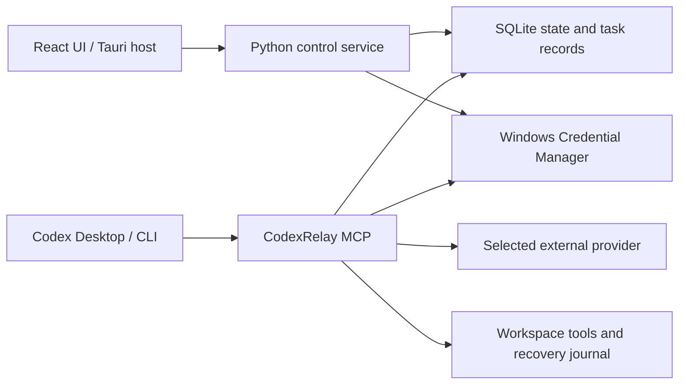

# Architecture

CodexRelay has a desktop control plane and an MCP execution engine. The GUI does not proxy Codex's main-model traffic.

The desktop host starts the bundled Python control service. Codex starts its own MCP process from the installed runtime. Both consult shared local state, so changing a switch does not require restarting Codex.

Before a new task, the engine checks the global switch, workspace policy, provider configuration and active-task state. The first release permits one active delegated task. Disabling delegation does not cancel it; explicit cancellation stops further execution and leaves partial changes for review.

Providers have Flash and Pro model slots plus a cumulative task token limit. API keys are kept in Windows Credential Manager. Configuration, jobs and recovery records are stored under the application data directory, which tests can override with CODEXRELAY_HOME.

Registration edits only the application's owned MCP entry and managed delegation block. It backs up host configuration, supports legacy DeepSeek import and detects foreign name conflicts. Codex's main provider and login remain intact.

The execution engine derives from the pinned upstream in vendor/. Read-only mode exposes file inspection; coding mode adds writes and commands. Commands run with host permissions. File mutations have recovery records, but command-generated changes require reviewing the entire workspace.

Thinking-mode history compaction preserves original assistant messages, tool calls and opaque reasoning content, while shortening older tool output. Codex remains responsible for task selection, ambiguous debugging and final acceptance.
