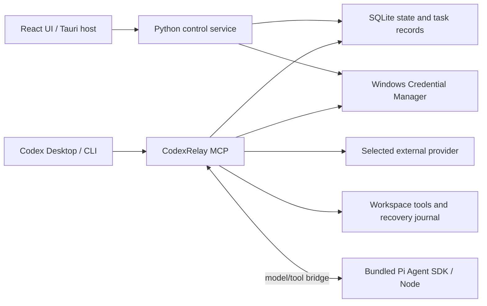

# Architecture

CodexRelay has a desktop control plane and an MCP execution engine. The GUI does not proxy Codex's main-model traffic.

The desktop host starts a bundled Python process per control request. Codex starts its own long-lived MCP process from the installed runtime. Both consult shared local state, so changing a switch does not require restarting Codex.

Before a new task, the engine checks the global switch, workspace policy, provider configuration and active-task state. The first release permits one active delegated task. Disabling delegation does not cancel it; explicit cancellation stops further execution and leaves partial changes for review.

Providers have Flash and Pro model slots plus a cumulative task token limit. API keys are kept in Windows Credential Manager. Configuration, jobs and recovery records are stored under the application data directory, which tests can override with CODEXRELAY_HOME.

Registration edits only the application's owned MCP entry and managed delegation block. It backs up host configuration, supports legacy DeepSeek import and detects foreign name conflicts. Codex's main provider and login remain intact.

The execution engine derives from the pinned upstream in vendor/. Read-only mode exposes file inspection; coding mode adds writes and commands. Commands run with host permissions. File mutations have recovery records, but command-generated changes require reviewing the entire workspace.

Thinking-mode history compaction preserves original assistant messages, tool calls and opaque reasoning content, while shortening older tool output. Codex remains responsible for task selection, ambiguous debugging and final acceptance.

Task-settlement usage reporting aggregates all retained tasks, including known usage from failures and cancellations. Provider/model prices are versioned and frozen at admission; historical backfill is explicit. Separate idempotent response events support request-day reporting and cache counters. Estimates use Decimal and distinguish missing usage, unknown caching and unpriced records. A frontend cache uses the shared usage revision and local day; aggregation does not enter snapshot polling.

Codex log import is a separate, default-off feature. It incrementally stores counters and cursors, never message bodies, and does not proxy main-model traffic. Pi scheduling uses a credential-free Node SDK process; all model requests and workspace tools return to the Python control boundary. Both backends share admission, workspace leases, transaction recovery and independent verification. Pi coding also persists observed-workspace checks. See [0.2.0 implementation and verified scope](ROADMAP-0.2.0.md).

## 0.3.0 execution contracts

TaskGroup identity, independent Run budgets, parent verification and App grants are persistent. Both schedulers share pre-request control and provider usage, including summaries and retries. Pi prepareRequest replaces scheduler state at complete exchanges. SQLite schema 4 separates lightweight task metadata from results, checkpoint bodies, tool evidence and sealed context archives; snapshots do not load those bodies. See [contracts and migration](EXECUTION-OPTIMIZATION.md).

The 0.3.1 patch shares adaptive long-line previews and target-first inspection across both schedulers. A real Grep match supplies the text for exact Edit; a broad Read is not mandatory. Budget feedback considers the cost of subsequent input history while the hard limit and usage history stay unchanged. No new schema or SDK dependency is required.

## 0.4.0 local reliability candidate

Schema 5 adds independent probe records, explicit client bindings, body-free MCP invocation references and experiment/trial/request/usage tables. Migration retains existing switches, providers, task history, recovery and prices. Call/report ledgers and experiment bodies are read on demand rather than entering two-second snapshots.

`capabilities.py` is the versioned contract checked against actual MCP registration. `integration.py` produces read-only repair plans with content fingerprints and applies only selected owned changes with encrypted backups and guarded recovery. `integration_evidence.py` keeps server declarations, configuration predictions, user reports and observed calls distinct. A client binding is explicit reported identity; the server cannot attest which desktop UI is open.

`connection_probe.py` owns killable response/tool/backend probes. `probe_service.py` records immutable attempts and provides revision-filtered views and independent probe usage. Actual backend probes share the task occupancy slot and verify tool results against an isolated random file marker. Credentials stay at the Python boundary, including when Pi schedules requests.

`evaluation.py` freezes materials, explicit session bindings, authorization and independent scoring. `request_gate.py` runs at the shared provider retry boundary before every actual attempt, including summaries and experiment-bound probes. Reservations remain charged when usage is unknown. Token/cost reservations are conservative local admission bounds; provider billing can differ. Main-model requests remain host managed. See [contracts and unverified real-client conditions](DELEGATION-ACCEPTANCE.md).
