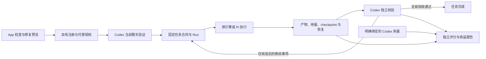

# CodexRelay 委托可靠性、真实闭环与收益评测 PRD

> 本文保留实施前的设计快照；随后用户已确认并实施 0.4.0。发布现状与未覆盖条件见 [验收矩阵](DELEGATION-ACCEPTANCE.md) 和 [发布记录](RELEASE-0.4.0.md)。下文“本轮设计”指原设计阶段。

- 文档版本：v0.1
- 日期：2026-10-15，Asia/Shanghai
- 基线：0.3.1 Windows Beta，以及工作区中尚未提交的连接测试与设置交互改动
- 状态：需求与技术设计评审稿；本轮交付为设计文档，实施待确认
版本建议：先以维护迭代完成缺陷修复，再以功能迭代交付诊断与评测；发布版本号在实施评审中确定

## 1. 产品目标与完成标准

让开发者继续在 Codex 中工作，由 Codex 理解目标、规划、判断和验收，外部模型承担独立执行任务。用户能够知道接入是否完整生效、任务是否真正通过验收，以及委托在指定任务上对主模型消耗、总成本和耗时的影响。

本期解决三件事：接入可靠性、真实 Codex 委托闭环、可复核的收益评测。以真实调用与产物为完成依据；总开关、模型与后端、预算、停止和恢复都沿用用户控制。

本期的产品完成标准为：

1. 接入检查能解释配置与客户端能力的差异，并给出可审阅的修复计划。
2. 快速连接、工具验证和执行后端验证按实际选择执行，结果与费用提示准确。
3. 在真实 Codex 客户端跑通委托、独立核验和剩余事项续作；证据能串起同一项任务。
4. 用固定任务和独立判据比较直接执行与委托执行，保留失败与负收益结果。
5. 本地确定性测试、真实客户端测试、真实外部模型测试分别报告，覆盖不足时保留未知状态。

## 2. 决策来源与当前事实

### 2.1 用户已确认的方向

| ID | 本轮已明确的方向 | 来源 |
| --- | --- | --- |
| D01 | Codex 保留规划和最终验收，外部模型承担执行 | 用户对产品目的的说明 |
| D02 | 先处理接入完整性、真实闭环和收益评测 | 前一轮评估提出三个重点，用户随后要求对应 PRD 设计规划 |
| D03 | 本轮先交付 PRD 与开发规划 | 当前请求；用户提供的 AGENTS.md 要求研究、设计、确认后实施 |
| D04 | 延续现有双后端、串行、恢复核验和有限续作 | 现有产品合同与此前已确认决策 |

本文件中的界面文案、字段组织、评测试次与里程碑是具体建议方案，供本次评审。它们不代表付费实验或修改日常配置已经获得授权。

### 2.2 2026-10-14 检查所得基线

| 事项 | 已观察事实 | 对本期的影响 |
| --- | --- | --- |
| 当前源码 | 0.3.1；包括任务组、checkpoint、独立核验及续作 | 优先补接入与验证，不重建执行循环 |
| 本地回归 | 176 项单元通过；TypeScript 通过；真实 stdio 回归枚举 29 个工具 | 这些结果是已有基线，不代表新增设计已实现 |
| 日常接入 | ping 返回 0.3.1、active_backend=pi、enabled=false；宿主白名单只允许 11 个旧入口 | 中性工具、验收与续作能力没有全部暴露；开关关闭是用户状态，不当作缺陷 |
| 参数传递 | 请求 Pro 的 quick，经 test_provider RPC 后实际返回 Flash 的 full，发出两次本地模型请求 | 修复分发并覆盖真实 RPC 路径 |
| 版本差异 | 工作区与开发 runtime 一致；日常安装的 Python 包尚未包含新连接探针及服务改动 | 诊断区分源码、安装 runtime 和连接实例 |
| 真实模型历史 | 已有低预算样本和独立验收记录 | 可复用证据方法；尚不足以证明普遍净收益 |

基线来自本地审查和隔离测试；机器上的开关、名单、供应商及历史记录保持原状。已有事实可参见 [0.3.1 验收](EXECUTION-ACCEPTANCE.md)和[执行合同](EXECUTION-OPTIMIZATION.md)。

### 2.3 GitHub 调研结论

已研究 deepseek-as-subagent、external-subagents-mcp、cc-switch、OpenAI Codex 与 SWE-bench。继续采用现有技术栈；借鉴诊断、修复预览、可定位报告以及固定实例与独立评分。候选架构、依赖、维护快照、取舍和可复核链接见 [GitHub 调研](RESEARCH-DELEGATION-RELIABILITY.md)。

## 3. 用户、主要流程与范围

目标用户是已有 Codex 的开发者：首次接入者、升级后能力缺失者，以及希望比较委托收益的使用者和维护者。用户无需掌握 MCP 名称及哈希；技术详情在诊断与证据中按需展开。

### 3.1 三条主要流程

| 流程 | 触发与步骤 | 用户得到的结果 |
| --- | --- | --- |
| 接入检查与修复 | 打开设置检查 → 看限制原因 → 预览选定修复 → 应用 → 重新连接 → 在 Codex 验证 | 清楚哪些能力可用、哪些仍需验证 |
| 日常委托 | 正常提出任务 → Codex 决定委托 → 外部执行 → Codex 检查产物 → 验收或续作剩余事项 | 在原聊天完成任务，App 展示真实阶段和障碍 |
| 收益评测 | 选择冻结任务集 → 预览预算与数据范围 → 直接／委托分组执行 → 独立评分 → 查看结果 | 了解指定任务的质量、消耗和耗时，而非只看外部 Token 数 |

### 3.2 范围与优先级

| 范围 | 优先级 | 本期交付 |
| --- | --- | --- |
| 连接测试参数与验证记录修复 | P0 | 端到端参数传递、分层结果、预算与耗时语义 |
| 接入完整性诊断与修复 | P0 | 有效工具集、能力缺口、规则版本、修复计划和重新连接验证 |
| 真实客户端闭环与证据关联 | P1 | 调用到任务、核验、恢复、续作的身份与证据关联 |
| 受控评测与收益报告 | P1 | 任务集、试次清单、独立评分、成本口径、覆盖和失败分类 |

后续独立规划：多代理并发、工作区隔离合并、自动模型路由、自动故障转移、新模型原生协议、macOS/Linux 分发、签名和自动更新。本期保留设计扩展点，发布范围仍为 Windows x64 单外部任务串行。

## 4. I：接入完整性诊断

### I01：分别表达四类能力证据

| 证据层 | 如何取得 | 能证明的内容 | 局限 |
| --- | --- | --- | --- |
| 服务端声明 | 注册的 runtime 提供工具目录、协议版本及能力合同 | 该安装引擎实现了什么 | 无法证明宿主已放行或加载 |
| 配置推算 | 只读解析注册、名单、工具策略及托管规则 | 已知配置下预计暴露的工具 | 宿主或组织的附加策略可能不可见 |
| 客户端报告 | 从明确的客户端验证记录取得版本、工具可见性和 workspace | 当前聊天报告看到了什么 | 报告本身仍需结合真实调用 |
| 实际调用 | 相应入口的成功调用记录和执行产物 | 本实例在该时点完成了哪些操作 | 单次成功不覆盖所有工作区、策略和模型 |

ping 应以兼容方式增加服务端能力版本、声明目录指纹和实例版本信息。其成功只说明该入口可调用。App 自己启动 MCP 枚举工具属于服务端自测，不能标记为真实 Codex 客户端验证。

暂不依赖跨客户端的内部 UI 自动化或不存在的聊天 API。没有可用客户端观测接口时，提供复制验证指令和结果导入路径；人工粘贴结果标记为用户报告，再结合引擎内实际调用核对。

### I02：按能力显示缺口

维护与实际 MCP 注册共用的版本化能力清单，而非在诊断和 UI 分别写死“29 个工具”。每个能力清单列出入口、允许的兼容别名、依赖入口及对应语义版本。

| 能力 | 检查重点 |
| --- | --- |
| 基础只读执行 | ping、readonly 委托／启动、状态和结果；旧入口只表达原引擎能力 |
| 选定后端执行 | 中性委托入口，以及任务冻结的 backend_id 和实际模型 |
| 编码后的恢复核验 | 恢复查询、精确事务确认、适用时的工作区检查确认 |
| 独立验收记录 | 核验入口及对应任务／checkpoint 合同 |
| 任务组与续作 | 创建／读取任务组、checkpoint、核验、续作与组取消 |

旧入口仍可按原合同使用。诊断可以显示“旧版只读可用；Pi 路由／核验记录／续作未启用”，避免把部分能力写成全部就绪或全部不可用。

静态解析至少覆盖：服务器未注册、外来同名注册、命令不存在、enabled=false、名单未配置、空名单、缺少中性入口、显式拒绝关键工具、逐工具策略、托管规则缺失／过期／标记损坏。解析语义以验证过的宿主版本为依据；不支持的字段或不可见策略显示未知。

### I03：状态与时效

配置、客户端、模型、执行后端和委托开关分别展示。建议主文案为“配置待修复”“配置检查通过，等待 Codex 验证”“当前聊天已验证”“部分能力受限”。关闭委托显示“新委托已关闭”，不诱导用户为了检查而开启。

观测绑定 runtime、配置与托管规则指纹、MCP 实例、规范化 workspace、客户端版本（能取得时）和验证时间。相关配置改变或实例重建使旧观测失效；无依据的客户端版本保持未知。App 重开不会凭旧记录直接认定新聊天已加载。

### I04：修复计划与应用

检查默认只读，不发模型请求。修复前生成计划，展示缺口、拟添加工具、冲突、受影响的注册和托管规则，以及重新连接要求。用户能够只启用基础能力或完整合同。

沿用 tomlkit、DPAPI 备份、配置归属与并发检查。新增工具以最小增量加入允许名单；保留额外条目和其他 MCP。显式拒绝不默认移除，需在具体计划中单独选择。用户选择维持限制后显示该限制对应的功能边界。

提交时再次核对预览时的文件版本；发生并发编辑则使计划失效，重新生成预览。配置与托管规则的应用形成可恢复操作：失败保留备份，并回退本次已应用部分。回退前核对目标仍等于本次写入版本；出现新的外部修改时保留恢复事项，避免覆盖后来编辑。更新规则只替换本软件拥有的完整标记块，不覆盖用户的其他规则。

应用成功显示“配置已更新，等待重新连接”，随后重新取客户端证据。不能通过本软件直接看到或控制的组织策略，给出具体原因和手动处理说明。

## 5. C：连接、工具和后端验证

### C01：参数与旧接口兼容

供应商列表、后端面板、真实 Tauri RPC、Service.dispatch 和探针必须完整传递供应商、slot、verification，以及适用时的 backend。无效参数在网络请求前拒绝。

旧调用未提供参数时保留既有默认行为；新 UI 明确提交所选模式。修复重点是 test_provider 分发丢失参数，并加入真正经过 dispatch 的回归。

### C02：三个不同验证结果

| 操作 | 实际行为 | 成功文案与边界 |
| --- | --- | --- |
| 快速连接 | 选定档位一次小模型请求；截止预算 12 秒 | “模型已响应”；不授予工具或后端已验证状态 |
| 模型工具验证 | 合成工具调用与工具结果回传；正常成功两次请求；整体预算 45 秒 | “模型工具协议验证通过”；不声称执行后端完成实际文件任务 |
| 执行后端验证 | 选定后端读取隔离文件中的随机标记；预算 45 秒且请求数／轮次有界 | “此模型与执行后端验证通过”；核对真实工具记录与标记 |

探针实际使用的推理模式、模型和协议随结果保留。快速探针采用普通模式时明确记录；普通模式工具验证不能代替所选 thinking 设置的完整后端验证。

截止时间从操作启动计算，包含冷启动和全部模型请求；到达截止时间终止在途请求及所属进程，清理耗时另记并设有限上限。模型测试不自动重放；SDK 重试关闭。后端探针沿用共享任务占用，避免与编码任务并发运行。

### C03：验证记录与计量

结果以供应商修订、模型档位、实际模型、模式、后端／适配器版本和验证层级为身份。快速成功不覆盖完整验证证据；测试期间配置变化时，结果保留为旧版本证据，当前配置保持待验证。

凭据变化后旧证据失效，持久化身份不含密钥或密钥内容哈希。返回结果、错误、日志、诊断和 Node 环境均不暴露 Key。

记录请求次数、耗时、截止／清理、已报告 usage 与缺口。连接探针作为独立 purpose=probe 消耗进入新统计，独立列出；保留原有“任务用量不含探针”的历史口径标签。历史探针没有用量时不补造零费用，也不伪造任务组。

## 6. L：真实 Codex 委托闭环

### L01：正常任务到独立验收

Codex 接收正常用户目标后，根据范围和合同判断是否适合委托。向外部代理传递完整目标、绝对 workspace、任务类型、工具能力、读写范围、验收条件及有界上下文。任务组记录固定合同；Run 冻结后端、供应商修订、模型和有效预算。

执行终态后，Codex 查询 checkpoint、检查实际产物和测试／引用，并核验恢复记录。全部通过记录 verified_complete；部分通过记录 verified_partial 和准确剩余事项；证据不足保留 needs_more_evidence。App 展示业务阶段，详情显示技术证据。

对正常目标没有派工时记录“未发生外部委托”，不要虚构任务记录或自动改总开关。它仍可能由 Codex 成功完成，但不计入有效委托完成。

### L02：部分成果、续作与接手

续作沿用当前组、有效 checkpoint、核验 ID 和幂等键，只提交已核验 remaining_items。沿用既有次数、预算、取消、项目开关、恢复和过期文件检查。完成内容和已成功验证随交接保留。

停止保留部分变更；取消链不会自行续作。用户明确选择恢复后，仍执行适用的独立核验与手动恢复合同。主代理接手完成记录 completed_by_parent，并计入主代理消耗；不伪造外部 Run。

### L03：真实客户端验收集

建议最少六条真实聊天：双后端各运行只读分析、编码并验证、部分成果后核验续作三种场景。记录客户端版本、可见工具和实际调用链。部分成果场景的停止条件在试验前定义，不假设某个真实模型一定达到固定 Token 阈值。

取消、steering、引擎中断、App 关闭、开关／项目禁用及重复幂等请求先在隔离确定性环境覆盖。真实客户端专项只声明实际跑过的场景。CLI 验证、App 自测、本地模型替身和真实 Desktop 聊天分别标记。

### L04：证据身份与归属

保留 experiment_id（适用时）、trial_id、case_id、输入版本、客户端观测引用、MCP 实例、workspace、group_id、run_id、checkpoint／核验引用和产物哈希。用户自己的普通任务无需为了使用软件填写评测字段。

客户端试次和 Codex root thread/session 通过显式确认绑定；时间窗口只能作辅助检查。无法明确绑定、存在 fork 继承、计数重复或其他聊天混入时降低覆盖状态。工具描述、自述、摘要和用户粘贴结果单独标识来源，不能替代独立产物评分。

## 7. E：受控对照评测

### E01：分组与任务集

| 组别 | 方式 | 比较目的 |
| --- | --- | --- |
| A | Codex 完成任务，隔离配置中关闭外部委托 | 同一主模型的直接执行基线 |
| B | Codex 规划／验收，原引擎承担明确执行 | 委托的端到端质量与收益 |
| C | Codex 规划／验收，Pi 承担明确执行 | 执行调度方式对质量与收益的影响 |

本期 B/C 使用同一供应商、真实模型档位与推理设置，便于观察后端影响。模型选择的比较另做独立实验。

建议首轮为五个固定案例、每组每案例三次：共 45 个完整聊天试次，包含 15 个直接执行和 30 个委托试次。试次不等于供应商请求数；重试、摘要、续作与探针按真实发生计量。六条真实客户端验收若符合相同冻结清单，可纳入首轮结果，避免机械重复。

| 类型 | 案例与独立判据 |
| --- | --- |
| implementation | 修复小型真实逻辑问题；预先冻结的功能和边界测试；检查变更范围 |
| testing | 执行既有测试并解释失败；确认实际命令、退出码及失败原因；源码哈希保持符合合同 |
| review | 检查带有已知缺陷和正常代码的样本；评分定位、影响与误报；禁止写入 |
| analysis | 从多文件／日志中回答预先定义问题；逐条核对来源、事实和不确定性 |
| documentation | 根据固定材料形成指定文档；检查必需事实、矛盾、来源及输出范围 |

每类一个案例只能作为试运行，不能代表该类别所有任务。后续扩充真实多文件工作与更难样本；难度、任务长度和许可在清单中记录。

### E02：公平性与冻结条件

冻结任务文字、初始文件、验收器、依赖、运行环境、主模型及可取得的推理设置、外部模型、配置与政策版本。各试次使用新聊天和独立 workspace；外部执行串行，避开上一试次残留和缓存评分。

按案例和重复轮次交替 A/B/C 顺序，并记录缓存与请求时间。正常工具集与内置子代理设置保持可比；主代理及其相关子聊天用量纳入覆盖检查。无法收齐相关消耗时不输出完整净收益。

父代理为委托填写执行合同属于 B/C 的真实开销，不从成本中删去。评分者使用固定判据检查实际文件与命令；执行代理的完成声明和自行改写测试不授予评分通过。

### E03：主要指标与分母

| 指标 | 定义 |
| --- | --- |
| 端到端任务完成率 | 独立评分通过的试次／全部已开始试次；包含主代理接手完成 |
| 有效委托完成率 | 已发生外部执行且外部成果最终验收通过的试次／预定委托试次 |
| 首轮验收通过率 | 首个外部 Run 成果独立验收通过／已发生外部执行的试次 |
| 主代理接手率 | 需要主代理补实现才能通过的试次／预定委托试次 |
| 未派工率 | 未发生外部执行／预定委托试次；区分主动决策、开关、接入、策略及错误 |
| 主模型消耗 | 明确绑定的主聊天及相关子聊天已报告输入／输出／缓存计数；计量缺口另列 |
| 总耗时 | 用户目标提交至最终验收；拆出队列、执行、核验、续作和接手时间 |
| 返工与续作 | 核验未通过、重做和后续 Run 次数；保留原因与产物版本 |
| 覆盖率 | 可归属、用量完整、可计价与独立评分完成的试次分别统计 |

所有失败、取消、预算停止、未派工、超时与费用未知保留在结果中；完成率分母使用全部已开始试次。若需要“成功试次成本”，必须与包含失败消耗的“每个验收成功任务总成本”并列。

### E04：成本与差值

直接组成本为完整主代理请求成本。委托组成本为完整主代理请求成本加全部外部请求成本，外部执行、摘要、重试和续作均计入。主代理规划、查询、验收、返工和接手已包含在主代理请求内，不能再加一次。

连接和环境准备探针作为实验准备成本单列；报告同时提供不摊销与明确摊销规则的视图。任何摊销都使用实际次数，不能把准备成本在多个统计层重复加总。

以同案例、同重复轮次的 A/B 或 A/C 配对。估算净差 = 直接组估算成本 − 委托组估算成本；负数正常呈现。金额区间分别为直接 [LA, UA]、委托 [LD, UD] 时，净差区间为 [LA−UD, UA−LD]。区间跨越零时标记收益方向不确定。

订阅额度与 API 费用分别呈现。Codex 订阅没有逐请求实际账单时，填写 API 参考价只能产生“参考价格估算”；主模型 Token 减少也不能直接换算为固定比例的订阅额度节省。价格、缓存计费和 currency conversion 使用冻结来源与时间；未知字段保持未知。

### E05：报告与数据边界

报告包含冻结清单、每个试次、配对结果、计量覆盖、质量、耗时、失败分类、版本与证据引用。首轮以小样本描述统计和原始分布为主，报告中位数及范围；不给普遍节省率或未经样本设计支持的显著性结论。

结果可区分“质量通过且收益方向明确”“质量通过、收益不确定”“成本增加”“质量未通过”“计量不足”。即使结果不利，也生成完整报告供后续改进。

Codex 日志导入沿用默认关闭与主动选择目录；绑定试次后仅保存会话标识、统计、来源指纹与游标。正文不进入用量缓存或默认报告。另需提供的聊天／工具原始证据保存在用户选择的本地目录，导出时独立选择并脱敏。

### E06：实验状态与累计授权

实验先为 draft，冻结清单后为 prepared；确认具体额度与数据范围后为 authorized，才可进入 running。正常结束为 finished；用户停止、额度不足或关键计量缺失分别保留 stopped／budget_stopped／needs_review，已有试次和已知消耗持续保留。配置准备与生成报告不触发模型请求。

实验范围内的外部请求共用累计登记，在发送前检查试次、任务组／Run 授权和实验剩余额度；执行、摘要、重试和探针全部覆盖。供应商返回实际用量后立即结算，供应商未返回用量时保留估算及缺口，不以缺口清零消耗。已超限或余量不足时禁止后续请求，追加额度需具体预览与新授权版本。

Codex 主模型继续由宿主管理；本产品没有截获其请求或保证在途请求可立即停止的能力。主模型额度采用已观测计量、试次上限和停止提醒；无法控制的在途消耗与延迟单独说明。订阅与价格缺失时，不能把参考金额当作实际账单硬上限。

## 8. 技术架构与模块边界

延续 Tauri 2／Rust、React／TypeScript、Python 3.12、SQLite、Credential Manager 和现有两个执行后端。App RPC 与 Codex MCP 继续共享本地状态。接入诊断不代理主模型网络请求。

| 模块 | 建议职责与对应位置 |
| --- | --- |
| 能力清单 | MCP 注册、诊断和测试共用版本化工具合同；结合 mcp_server.py 与 backends 注册 |
| 接入诊断与修复计划 | integration.py 拆出只读检查、计划生成与校验后应用；保留既有备份／归属／并发处理 |
| 连接探针 | service.py、connection_probe.py 与 ConnectionTest.tsx 完整传递参数，冻结分层结果 |
| 客户端观测 | 在实例与任务记录上增加版本、来源和时效；实际调用记录与报告分开 |
| 评测控制与清单 | 新增本地评测模块，控制案例／试次状态、绑定、授权与独立评分引用 |
| 用量归属与报告 | 扩展 codex_usage.py、usage.py；保留既有日用量口径，新增显式实验视图 |
| 界面 | 设置中显示接入诊断与修复预览；评测作为明确进入的工具页面；普通任务流程保持简洁 |

建议持久化 integration_check、repair_plan、client_observation、probe_record、experiment、trial、score 与 artifact_reference。需要新表时采用明确 schema 升级和事务迁移；详细字段及升级号在实现设计中固定。大段证据继续按需加载，不进入两秒 snapshot 全量读取。

实验与评分引用包含输入哈希、验收器版本和产物哈希；任一变化使旧评分失效。历史任务、价格和恢复记录不伪造实验身份、不回填新客户端验证。跨后端恢复门禁沿用现有实现。

## 9. 非功能要求与异常处理

| 项目 | 要求 |
| --- | --- |
| 权限与开关 | 检查和评测准备不能开启日常委托、修改模型或重置限额；实验用隔离配置 |
| 修复一致性 | 外来注册、破损标记、并发配置修改、无法备份／写入均有明确失败状态与恢复路径 |
| 时间控制 | 网络探针有端到端截止；静态诊断不联网；实验试次有冻结上限和可取消状态 |
| 恢复 | 引擎中断后保留文件、事务和观察检查；已开始试次保留中断记录，重新执行形成新尝试身份 |
| 数据完整性 | 请求事件幂等；fork／重放去重；日志截断和缺失使覆盖下降，不默默补齐 |
| 凭据与正文 | Key 不进入参数日志、argv、Node、导出；默认诊断与统计报告不含项目正文 |
| 命令作用域 | 延续 trusted-host；命令生成变化需独立检查；界面及报告不声称 OS 沙箱 |
| 兼容 | 原 DeepSeek 命名入口保持原引擎语义；新增能力目录、观测和元数据使用增量方式 |
| 布局与可访问性 | 主流程在现有 900×600 和 800×520 窗口可操作；键盘可审阅、关闭与确认计划 |

## 10. 验收矩阵

| ID | 必须通过的验收 | 方法与证据层 |
| --- | --- | --- |
| I-A01 | 名单未配置、空名单、允许、拒绝、逐工具限制及服务器禁用分别给出正确能力状态 | 单元＋真实宿主语义核对；未知策略保持未知 |
| I-A02 | 本机同类 11 旧入口 fixture 定位缺失中性路由、核验和续作；保留旧功能说明 | 隔离配置＋真实 RPC |
| I-A03 | 诊断能力清单与实际 MCP 注册一致，新增／删改工具会触发一致性失败 | 真实 stdio 枚举＋合同断言 |
| I-A04 | App 自测、ping、配置应用不冒充当前 Codex 全能力验证 | 状态机＋UI／RPC 集成 |
| I-A05 | 修复预览只改所选自有配置；保留其他 MCP、名单、注释和用户规则 | 隔离真实 TOML／AGENTS 文件差异 |
| I-A06 | 显式拒绝默认保留；选择解除时预览明确；并发修改使计划失效 | 配置故障与并发注入 |
| I-A07 | 应用第二步失败可以恢复本次变更且保留备份；外来注册不能被接管 | 文件失败注入＋实际内容核验 |
| I-A08 | 配置／规则／实例变化使客户端观测失效；重连后重新取得证据 | 生命周期＋真实客户端专项 |
| C-A01 | Flash／Pro × quick／full 参数经过真实 RPC 到达供应商正确模型 | 本地 HTTP 计数和请求体；包含供应商列表 |
| C-A02 | 快速成功只有一次请求，不授予工具或后端验证；正常工具验证两次请求 | 本地模型替身＋UI 状态 |
| C-A03 | 后端验证真的读取随机标记；与普通工具验证、推理模式区分 | 真文件＋实际双后端 SDK／工具 |
| C-A04 | 冷启动、慢响应／持续小包、401／429、超时及导航离开正确结束；无自动重放和残留进程 | 隔离 HTTP＋进程＋浏览器／RPC |
| C-A05 | 快速、不同档位和旧修订结果不会错误覆盖当前完整验证 | 修订竞争与身份回归 |
| C-A06 | 探针用量独立记录、无重复计入；缺用量保持未知 | 固定计量输入＋日／实验汇总 |
| L-A01 | 六条真实聊天覆盖两后端三场景，任务模型与路由和产物相符 | 真实 Codex 客户端；标出外部模型是否真实 |
| L-A02 | 执行结束先待核验；摘要／自述不足以通过独立验收 | 真实产物＋核验状态 |
| L-A03 | 清除精确恢复及适用的工作区检查后，仅当前已核验剩余事项可续作 | 双后端真实工具＋checkpoint／哈希 |
| L-A04 | 开关、项目禁用、取消、中断、App 退出、幂等和过期证据保持原合同 | 隔离故障／生命周期；覆盖层单列 |
| L-A05 | 未派工、主代理接手和能力受限各有真实状态及归因 | 实际聊天＋任务事件关联 |
| E-A01 | 三组初始材料和评分版本一致，试次隔离，评判不依赖代理自评 | 清单哈希＋独立评判器 |
| E-A02 | 显式会话绑定，重复、fork、缺失及混入记录不会产生完整覆盖假象 | 日志 fixture＋人工核对真实样本 |
| E-A03 | 全部失败与未派工保留；正确计算各分母、成功成本及总成本 | 手算案例＋已知结果集 |
| E-A04 | 主代理与外部成本不重计；缓存、区间、负收益、缺价和订阅口径正确 | 十进制算例＋来源核对 |
| E-A05 | 试运行完整报告可复核；没有预算时不发送真实模型请求 | 清单／授权门禁＋实际试验记录 |
| E-A06 | 产物或验收器变化后旧评分失效；导出不含 Key 和默认排除的正文 | 哈希失效＋导出检查 |
| E-A07 | 试次、Run 和实验累计授权均阻止新的超限请求；中断用量不清零；主模型控制边界明确 | 固定请求序列＋额度／中断故障注入＋实际报告 |
| R-A01 | 现有回归与安装升级符合改动范围，原工具和历史保持兼容 | 单元、stdio、生产前端／原生 RPC、隔离安装升级 |

验收报告逐条填写：实现状态、验证方法、实际证据和未覆盖环境。只有方法被执行且证据存在时标记通过。

## 11. 开发顺序与阶段出口

| 阶段 | 工作 | 出口与依赖 |
| --- | --- | --- |
| M0：缺陷修复 | 分发参数；补 RPC 测试；分层与修订验证状态 | C-A01～05；已有未提交改动先整体审阅，避免重复实现 |
| M1：接入完整性 | 共用能力清单；只读诊断；修复计划／备份／并发；客户端观测时效 | I-A01～08；不以配置写入代替客户端验证 |
| M2：真实闭环 | 固定六场景验收清单；身份关联与证据；重连和剩余事项续作 | L-A01～05；依赖 M1 能力完整，真实测试按批准清单执行 |
| M3：收益试运行 | 冻结任务与评分；用量绑定；累计授权；成本口径；三组试次与报告 | E-A01～07；完整保留结果，包括负收益与覆盖不足 |
| M4：交付与发布评审 | 安装升级、文档、证据索引、许可及对外范围 | R-A01；功能范围和收益宣称分别评审 |

功能发布门槛是本期合同验收及明确覆盖范围。真实收益为正不是伪造或隐藏失败的理由；若结果显示某类任务不适合委托，交付该结论与改进事项。

对外节省宣称必须基于已冻结的任务、质量通过的比较和足够的计量覆盖，标出样本与估算方式。首轮 45 试次属于建议的试运行规模，不作为普遍统计证明。

## 12. 实施评审与实验启动前检查项

开发评审首先确认本 PRD 的功能范围、修复计划交互和阶段顺序。实施后付费试验另有具体启动清单，不能复用历史实验授权。

| 项目 | 当前状态 | 在何时固定 |
| --- | --- | --- |
| 产品方向及三项重点 | 已明确 | 本文 D01～04 |
| 修复预览、证据层级、探针分层 | 本稿具体方案 | PRD 确认后实现 |
| 发布版本号 | 尚未固定 | 首个实施计划／发布评审 |
| 首轮五案例 × 三组 × 三次 | 建议规模，可按授权缩小并明确统计局限 | 实验清单确认 |
| 真实主模型、外部模型、供应商与推理设置 | 尚未固定 | 实验开始前冻结 |
| 总费用上限、主模型额度上限、外部组／轮预算及停止条件 | 尚未授权 | 实验开始前必须明确；不以单轮预算代替实验总上限 |
| Codex 会话数据、绑定与本地原始证据目录 | 默认保持既有隐私选择 | 用户主动选定后采集 |

没有真实客户端控制接口时采用明确的人工启动／确认流程；完成所有可自动化的准备、评分和报告。无法取得的宿主计量保持未知，不能用更多外部任务测试代替净收益验证。

本 PRD 交付后，代码实施按用户提供的 AGENTS.md 经确认进入；当前设计不执行日常接入修复、付费模型请求、安装更新、提交、推送或发布。
