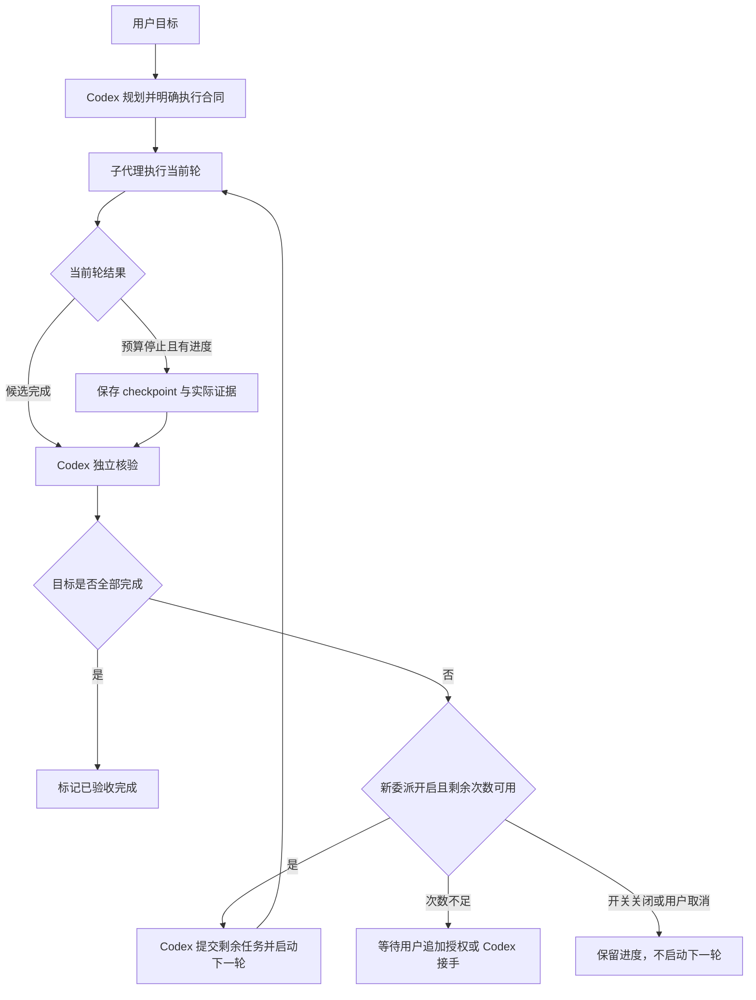

# CodexRelay 执行效率、上下文管理与核验后续作 PRD

文档版本：v0.1  
基线版本：CodexRelay 0.2.2 Windows Beta  
计划版本：下一功能版本，建议按 0.3.0 组织；发布版本号待评审  
日期：2026-10-13（Asia/Shanghai）  
状态：需求评审稿。已确认产品决策见第 3 节；建议参数和待定设计不代表已经获得实施确认。  
交付范围：本文件是需求与验收定义，不表示功能已实现，不改变已发布软件、用户配置或日常委托开关。

## 1. 产品定义与本次迭代的一句话目标

让一个外部子代理在合理预算内更有效地执行明确任务：少读无关内容，按需压缩上下文，停止时保留可核验进度，由 Codex 核验后继续委派剩余工作，最终由 Codex 完成验收。

用户继续在 Codex 聊天中提出需求。Codex 的当前主模型负责理解、规划、任务拆分、重要判断和最终验收；CodexRelay 提供外部模型的执行能力、预算控制、进度与证据记录、压缩和受控续作。用户希望由 Astra 等主模型规划、其他模型执行，是这个分工的典型使用方式，产品不绑定特定 Codex 主模型名称。

本期完善单代理串行执行。多代理并行、多个写入者的冲突解决、任务依赖图调度单独立项。本期的数据结构应能表达一项任务的多个执行轮次，但不得据此宣称已支持并发。

## 2. 背景、真实问题与当前基线

### 2.1 用户观察到的问题

1. 子代理任务容易以“本地任务 Token 预算已用完”结束。
2. 用户难以分辨供应商默认预算、Codex 单独指定的预算、单次上下文容量和累计用量。
3. 同一任务可能已经产生部分修改，但界面主要呈现“失败”，不清楚还能如何继续。
4. 任务多轮执行时重复发送历史内容；一次读取过大和重复读取会放大累计消耗。
5. 用户期望 Pi 能提供上下文压缩，但当前接入的 Agent Core 并不等同于完整 Pi 编程代理应用。
6. 用户希望子代理不仅承担编程，也承担测试、审查、资料分析和文档处理。
7. 用户希望核验后继续委派，减少主模型接手全部执行工作的情况，同时允许在 App 中调整授权。

### 2.2 案例还原：UI 子任务因预算停止

| 项目 | 已观察到的事实 |
| --- | --- |
| 任务 | 修改总览供应商字号、执行后端面板说明及控件样式 |
| 历史任务 ID | `e4582cd7480b4d77b1c19e409c0f5e0e` |
| 执行环境 | 当时的 0.2.0 原执行引擎，模型为 deepseek-flash |
| 单轮上限 | Codex 显式传入 100,000 Token；供应商默认上限为 1,000,000 |
| 已报告用量 | 92,517 Token |
| 本地预算计量 | 92,587 Token |
| 下一次输入估算 | 8,966 Token，已超过剩余可用空间，尚未包含足够的输出额度 |
| 中间结果 | 已修改 1 个文件，包含需要核验的写入记录 |
| 实际处理 | 主代理读取修改、确认恢复记录，再接手剩余工作 |

该案例表明：停止不等于账号余额不足，也不等于一个上下文已经容纳 10 万 Token。累计用量包含多轮重新发送的输入历史。即使数字尚未到上限，预计下一次请求无法容纳时也应停止。

这是一条历史记录，不能由此推断 0.2.2 又在运行旧版引擎，也不能把一次案例外推成所有任务的失败原因。后续优化需要建立有代表性的测量基线。

### 2.3 当前实现事实

| 能力 | 0.2.2 的实际情况 | 本期需要补齐的部分 |
| --- | --- | --- |
| 主代理与执行代理分工 | 托管 AGENTS.md 规则与 MCP 工具说明引导 Codex；模型决定何时委派 | 执行交接合同、核验后续作入口与规则；不承诺所有执行都会外包 |
| 并发 | 全局最多一个活动外部委托，另有工作区租约 | 保持串行，正确交接轮次 |
| 预算 | 每次委托累计限制，默认 1,000,000；显式 token_budget 可覆盖默认值 | 预算来源、轮次、累计展示及追加授权 |
| 压缩触发 | 历史达到字节阈值后机械压缩，常规阈值为约 128,000 字节 | 按模型上下文与剩余预算判断，增加结构化语义摘要 |
| 思考历史 | 存在 reasoning_content 时保留原 assistant、调用 ID 和协议字段，缩短旧工具结果 | 在保持协议完整的前提下进行新的上下文段重建 |
| 普通历史 | 旧完整工具交换可被替换为摘录并合并 | 保留任务意义、决策、证据及未完成事项 |
| 两后端临界处理 | 原引擎预算不足时可再强制压缩；Pi 调用路径没有完全相同的兜底 | 使用统一的预请求控制流程 |
| Pi | Agent Core 负责调度；模型请求、预算、工具执行返回 Python | 将压缩后的上下文同步到调度状态，不只缩短临时传输副本 |
| 读取 | 支持 offset/limit，未指定时可能读取整个文本；结果上限约 50,000 字符 | 默认有界读取、单行大文件处理与重复读取反馈 |
| 无进展保护 | 已检测重复等价失败和重复修改回退 | 对重复成功读取进行效率反馈，不把只读分析误判为无进展 |
| 恢复 | 文件写入 journal、Pi 工作区检查与主代理核验 | 将恢复记录与业务进度 checkpoint 关联；摘要不能替代恢复核验 |
| 任务类型 | 工具可支持多种工作，但系统提示词仍称 coding sub-agent | 通用执行代理定位及任务类型合同 |
| 复验 | 当前记录入口主要面向 completed 任务 | 部分完成、预算停止等终态的独立核验与续作资格 |

代码参考：`engine/codexrelay/mcp_server.py`、`state.py`、`failures.py`、`backends/pi.py`、`pi_bridge.mjs`、`vendor/deepseek-as-subagent/src/deepseek_mcp/agent_loop.py`、`history_compaction.py`、`tools.py`、`progress_guard.py`。

## 3. 需求访谈与已确认产品决策

本轮使用用户指定的 grill-me 访谈方式。下面记录的是实际已确认内容，不将建议参数冒充用户决定。

| ID | 已确认决策 | 来源或说明 |
| --- | --- | --- |
| D01 | Codex 核验已有成果后，把剩余工作继续交给子代理 | 用户明确选择核验后继续委派 |
| D02 | 本期完善单代理串行，多代理并行留下一期 | 用户明确选择 |
| D03 | Pi 和原执行引擎同等支持本期能力 | 用户明确选择 |
| D04 | 每轮使用独立预算，续作次数有限 | 用户倾向更实用的独立轮次方案，并继续讨论设置入口 |
| D05 | 默认最多自动续作 3 次，总共最多 4 轮 | 用户在明确选项中选择 3 次续作 |
| D06 | App 提供默认配置与单任务扩展授权 | 已向用户解释默认设置和任务详情入口；用户基于该设计选择默认次数 |
| D07 | 不能通过压缩清零已经消耗的 Token | 技术与计量约束，延续现有真实计量 |
| D08 | 用户界面保持简洁，技术信息分层展示 | 延续本会话已确认的界面方向 |
| D09 | 本次先形成详细 PRD 并讨论，再进入实施 | 当前请求的明确范围 |

**本 PRD 不采用共享整项任务硬预算作为默认模式。** 同一任务组仍累计显示总用量，但每轮有自己的预算。本轮预算耗尽后，经过核验可以开启下一轮；不能因此丢失上一轮的用量和费用。

## 4. 用户、角色及职责

### 4.1 目标用户

- 已使用 Codex Desktop 的个人开发者，希望减少主模型承担重复执行工作的比例。
- 使用 DeepSeek 或 OpenAI 兼容供应商的用户，需要清晰的额度、进度和恢复入口。
- 有较长代码、测试、审查或文档任务的用户，需要连续工作但不希望无限执行。
- 不熟悉上下文容量、累计计量及模型调用协议的用户。

### 4.2 职责分配

| 角色 | 负责 | 不应自行决定 |
| --- | --- | --- |
| 用户 | 业务目标、重要范围变化、App 授权额度和续作次数 | 无需逐轮手动阅读全部工具日志 |
| Codex 主模型 | 澄清、规划、拆分、选执行类型、检查真实成果、判断是否续作、最终验收 | 不得自行提高用户设置的上限或把子代理自述当作验收 |
| 外部执行代理 | 明确范围内的读取、实现、测试、审查、分析、文档处理、进度报告 | 不擅自改变任务目标、扩大权限或自行授予下一轮执行额度 |
| CodexRelay 控制层 | 接收门禁、预算、状态、checkpoint、恢复记录、计量和续作条件 | 不替代主模型的语义验收，不在主模型离线时自行开启任务链 |
| Pi/原引擎 | 按统一合同执行模型与工具循环 | 不绕过共同的预算、停止、恢复和授权规则 |

外部代理仍可以做执行所需的局部判断，例如选择具体修改方法、解释测试失败。需要业务取舍、目标澄清或扩大范围时，返回主代理处理。

## 5. 本期范围与明确排除

### 5.1 必须交付

1. 每轮预算来源与计量展示。
2. 默认有界工具输出、重复读取反馈和面向执行的任务提示词。
3. 两后端统一的上下文压力、预算预检查、压缩与停止流程。
4. 结构化任务摘要与持久化 checkpoint。
5. 部分完成和预算停止的状态表达。
6. Codex 独立核验后续作；默认 3 次自动续作、4 轮。
7. App 默认配置、当前任务扩展授权与审计记录。
8. 编程、测试、审查、分析、文档处理的任务合同。
9. 已发布接口兼容、旧记录兼容、故障恢复及测试证据。

### 5.2 本期不交付

- 多代理并行、并发写文件、跨代理冲突合并、DAG 调度。
- 替换 Codex 的主模型、登录、原有聊天界面或网络请求路径。
- 完整 Pi CLI、其插件市场、全局凭据库和所有原生应用功能。
- 子代理自行联网安装插件、选择新的供应商或解除用户限制。
- 自动绕过预算、取消或总开关；无限续作。
- 全格式文档解析、独立联网研究代理、自动部署或发送外部消息。
- 将摘要宣传为无损记忆，或保证所有任务一定在四轮内完成。

## 6. 产品目标与评价方法

### 6.1 必须达到的行为目标

| ID | 目标 | 判定方式 |
| --- | --- | --- |
| G01 | 预算停止时保留已产生的进度、计量与恢复信息 | 停止后的结果、checkpoint 和实际文件可对应 |
| G02 | 避免低默认读取效率放大累计消耗 | 大文件默认返回有界片段，并能准确分页 |
| G03 | 下一轮只执行核验后的剩余事项 | 不重放已完成写入，不重复成功验证 |
| G04 | 压缩在两后端上保持相同语义 | 同一固定响应序列的预算、压缩、停止和续作结果一致 |
| G05 | 用户能解释当前限制 | 详情中可看到本轮上限、来源、累计消耗和剩余续作次数 |
| G06 | 结束状态真实 | 执行完成、主代理验收通过、预算停止分别记录 |
| G07 | 用户控制优先 | 开关关闭、项目禁用、取消和额度限制均不能被续作绕过 |

### 6.2 效率实验

建立固定任务集：三文件 UI 修改、较大单行 CSS/JSON 处理、测试失败修复、只读审查、跨多份文本的文档整理。记录模型、供应商、版本、采样设置、预算、缓存命中、任务范围和真实结果。

以 0.2.2 为基线比较：端到端完成率、已报告 Token、含估算计量、重复读取比例、首次有效修改前的请求次数、压缩次数、续作次数、主代理接手比例、错误恢复次数。

固定本地响应测试验证机制正确性；真实模型实验验证执行质量。两者分别报告，不用本地响应通过率代替模型质量。

Token 降幅和完成率目标在基线测量后确认。本 PRD 不预先承诺节省固定比例或完全消除预算停止。

## 7. 名词、对象与预算语义

### 7.1 核心对象

| 名词 | 定义 |
| --- | --- |
| TaskGroup，逻辑任务组 | 同一个用户目标及其执行链，含多轮委派和主代理核验 |
| Run，执行轮次 | 一次真实子代理执行，具有独立模型配置、预算、计量、终态和证据 |
| Round，展示序号 | Run 在组内的序号，初始为第 1 轮 |
| Continuation，续作 | Codex 核验后针对剩余工作建立新 Run，仍属于同一 TaskGroup |
| ContextEpoch，上下文段 | 同一 Run 内一次上下文重建后的消息段；不产生新的执行预算 |
| Checkpoint，进度检查点 | 目标、约束、任务摘要、证据与剩余事项的持久化集合 |
| Verification，核验 | Codex 对实际文件、测试、恢复记录和剩余范围的独立检查 |
| Authorization，授权 | App 中对默认政策或当前逻辑任务的额度、次数进行设置或追加 |

### 7.2 默认次数的精确定义

- 初始执行为第 1 轮，不叫第一次续作。
- 自动续作最多 3 次，对应第 2、3、4 轮。
- 同一 Run 内的 API 重试、上下文压缩、语义摘要、steering 不算新的续作。
- 续作在通过接收门禁并建立新 Run 后计数；接收因禁用、忙碌、输入不合法而被拒绝时不消耗次数。
- 已接收 Run 后的 API 失败、预算停止或进程失败不自动退还次数，避免错误循环获得无限机会。
- 已使用次数不可因摘要、重启、改名、模型切换或更换后端而清零。
- 用户追加一次授权表示增加一个可用执行轮次，保留原已使用次数与全部消耗。

### 7.3 两类数字必须分开

| 指标 | 含义 | 是否能因续作变化 |
| --- | --- | --- |
| 本轮预算 | 当前 Run 的累计调用额度 | 新 Run 有新预算；当前 Run 的预算快照不自动改变 |
| 本轮已报告用量 | 供应商实际返回的该轮用量 | 只增不清零 |
| 本轮本地计量 | 已报告和必要估算形成的预算判断依据 | 只增；校正必须保留来源和审计 |
| 单次请求上下文 | 下一次发送的消息、工具定义及附加内容大小 | 压缩后可以减少 |
| 任务组累计用量 | 组内所有 Run 及摘要请求的已知消耗总和 | 新轮次继续累加 |
| 已使用续作次数 | 已建立的续作 Run 数 | 只增不清零 |

例如每轮 100 万，默认最多四轮，外部执行的配置额度总和最多可达到 400 万；这不是预先扣费，也不是实际账户余额。实际消耗由请求决定，缺失账单数据仍标记未知。用户追加授权后，该潜在额度随之增加，App 需展示变化。

任务组外部累计用量不包含 Codex 主模型的输入输出。主模型由 Codex 管理，现有可选日志对照可以单独展示；不得把不完整的主模型日志并入外部执行硬限制后声称全程精确计量。

## 8. 用户故事及正常流程

### 8.1 普通任务在一轮完成

1. 用户在 Codex 提出任务。
2. Codex 明确目标、范围、任务类型和验收标准，创建逻辑任务组并提交首轮。
3. 子代理按需读取、执行和验证；控制层记录请求、工具、文件及预算。
4. 子代理返回候选完成摘要与证据，Run 进入待核验。
5. Codex 检查实际成果，确认写入记录/工作区检查事项，记录核验。
6. 全部目标完成后，逻辑任务组显示“已验收完成”。

### 8.2 预算停止后继续委派

自动续作的“自动”表示用户已经设置允许次数，在范围内无需每轮重复同意。触发者仍是处于工作状态的 Codex；软件不因为一个 worker 停止就直接跳过核验启动下一个 worker。

### 8.3 Codex 不在工作状态

子代理可以完成或停止现有 Run 并保存结果，任务组保持“等待 Codex 核验”。关闭管理 App 不影响 Codex 托管的现有引擎；关闭 Codex 或引擎中断时，按恢复流程处理。App 不独立启动主模型，也不承诺自动唤醒已关闭的聊天。

## 9. 功能需求：预算与授权

### F-BUD-01 预算来源

- 默认不要求 Codex 显式传较低 token_budget，继承供应商的每轮预算。
- 显式较低预算继续生效，不能为提高完成率而悄悄覆盖用户或调用方的数值。
- 在结果和详情中显示实际生效额度及来源：供应商默认、Codex 指定或用户单任务授权。
- 低预算仍可用于短任务。只提示来源，不因小于供应商默认值就自动拒绝。

### F-BUD-02 本轮请求预检查

每次执行、摘要和必要重试的模型请求都先判断：剩余时间、取消、预计输入、输出空间和本轮剩余额度。摘要调用也计入本轮，不另开隐藏预算。

同一预算对象供两后端使用。不得通过 Pi 自有调用、摘要辅助调用或请求重试绕过统一计量。已收到的响应在后续预算停止前持久化，避免最后一次消耗丢失。

### F-BUD-03 提前收敛

- 向子代理提供一次清楚的剩余额度反馈，要求优先完成当前局部修改、整理证据和剩余事项。
- 不应等完全无法发出摘要请求后才第一次尝试保存进度。
- 未达到硬上限但下一次请求无法容纳时，可以执行有意义的紧缩；仍不能容纳则保存 checkpoint 并结束当前轮。
- 当前轮结束前需要等待正在执行的工具退出，不在写入中途截断以伪造整洁进度。
- 同一个阈值提示不在每次轮询中重复弹出。

建议起始参数：80% 进入预算提醒区，90% 或无法容纳下一次普通执行请求时优先收尾。实际触发应结合预计输入/输出和摘要额度，不能把百分比当作唯一条件；参数待评审和实验校准。

### F-BUD-04 默认政策与快照

- App 可设置默认自动续作次数，初始值为已确认的 3。
- 每轮预算默认来自供应商已有配置，首版无需增加一个重复的全局 Token 数字。
- 逻辑任务创建时记录默认政策快照；修改默认值只影响新逻辑任务。
- 当前 Run 配置保持冻结。为当前逻辑任务设置的预算调整在后续轮次生效，不回写历史预算。
- App 文案必须说明“仅影响新任务；调整当前任务请进入任务详情”。

### F-BUD-05 当前任务扩展授权

任务详情提供“追加一次执行机会”和“调整后续轮次预算”。用户确认前展示：原剩余次数、新剩余次数、已消耗、下一轮预算及潜在新增额度。

授权记录必须持久化，包含任务组、操作来源、时间、旧值、新值和政策版本。追加额度不删除历史用量。授权不会自动打开总开关，不会跳过核验，不代表最终成果已经合格。

App 可以向当前逻辑任务授予高于供应商默认值的后续预算，但仍应受软件支持范围约束，并记录为用户单任务授权；不修改其他任务或供应商默认值。未获得该授权的 MCP 调用不能自行超过供应商默认限制。

本期保留现有 Token 数值合法范围作为实施起点，具体最小/最大值与验证规则在技术评审中确认。次数上限的 UI 合法范围也列为待定，不把默认 3 当作不可调整的硬编码。

### F-BUD-06 超过默认次数

- 第四轮结束后，如果仍有未完成工作，停止自动委派，进入“等待追加授权/主代理处理”。
- Codex 可以在原用户目标和权限内自行完成剩余工作；该行为不计作外部子代理第五轮。
- Codex 若要再次委派，必须看到当前任务组新增的有效授权。
- 不得以新建一个同目标任务组、改标题、换后端或换模型规避次数限制。托管规则必须明确复用任务组，服务端对正常续作链执行计数。
- 不承诺通过程序识别任意自然语言同义目标，也不把 trusted-host 环境宣传为无法被主机操作绕过的安全沙箱。

## 10. 功能需求：读取效率与无效循环

### F-READ-01 默认有界读取

Read 默认返回有限范围，并同时返回文件总大小、当前范围、截断原因和后续读取方式。完整读取仍可显式请求，但需满足本轮工具输出和上下文额度。

建议起始范围：普通文本约 200 行，同时设独立字符/估算 Token 限制。数值待评审；不能只有行数限制，否则单行 CSS、JSON 或日志仍会一次返回大量内容。

### F-READ-02 搜索结果收敛

- Glob 先返回有界文件列表与剩余数量，不自动读取所有匹配文件。
- Grep 返回匹配位置及有限片段，限制结果数量与单行长度。
- 批量任务先定位目标，再按文件/片段处理。
- 原始大输出可保存在本地证据中，由主代理按需查看；模型消息不应默认携带完整日志。

### F-READ-03 重复读取反馈

识别相同规范路径、相同范围、相同内容版本的重复请求。若内容仍在当前上下文，优先提示已有结果；若已被压缩、文件改变或正在进行编辑前核对，允许重新读取。

缓存与文件版本、范围和上下文段关联，禁止因“读过一次”就一直提供过期内容。提示可以引导代理改用搜索、缩小范围或直接执行，但不把所有重复读取当作错误。

### F-READ-04 无进展的边界

- 延续当前重复等价工具失败和修改回退保护。
- 新增重复成功读取的统计及反馈。
- 只读审查、资料分析的进展可能是新证据或结论，不是文件修改。
- 未改源码不能单独作为失败依据。
- 主代理看到进展不足时应收窄任务、调整策略或接手，不重新提交一模一样的大任务并从头阅读。

## 11. 功能需求：统一上下文控制与语义压缩

### F-CTX-01 统一预请求流程

两后端使用同一控制流程：检查取消/期限 → 组装完整请求 → 评估上下文与本轮预算 → 有必要时压缩 → 再估算 → 发出请求或保存进度并停止。

首次估算必须包含消息、工具定义和实际附加内容。Pi 与原引擎临界预算处理结果应一致，不能只有一个后端尝试强制紧缩。

### F-CTX-02 压缩条件

至少支持以下条件：

1. 已知模型上下文窗口的占用接近设定阈值。
2. 下一次请求体持续增长，旧历史贡献较大。
3. 本轮剩余额度不足以容纳普通请求，但紧缩后仍可能有效执行或收尾。
4. 服务端明确报告上下文过大，且该请求没有需要重放的工具副作用。

不应在每一次请求前都调用摘要模型。先使用有界工具输出和机械紧缩，再在需要时生成语义摘要。

### F-CTX-03 模型上下文信息

当前 Pi bridge 的固定 contextWindow 不能当作任意供应商模型的真实容量。模型窗口应来自已配置或可验证的模型信息，随 Run 冻结。

信息未知时显示“上下文上限未配置”，采用保守的请求体增长策略；不展示伪精确占用百分比。可在高级设置补充模型上下文容量。未知窗口的建议阈值和配置入口为待评审参数。

### F-CTX-04 三层记忆

| 层次 | 内容 | 处理方式 |
| --- | --- | --- |
| 固定合同 | 原始目标、用户约束、允许写入范围、禁止事项、验收标准 | 保留明确权威来源，不被摘要重写 |
| 工作摘要 | 已调查事实、决策、完成候选、失败尝试、剩余工作 | 语义压缩并标记来源与核验状态 |
| 近期交互 | 当前局部操作及最近完整工具交换 | 保留原始协议形式 |

完整旧日志保留在本地证据层，摘要不是唯一恢复材料。不得把从文件或工具输出读到的文本升级为新的用户指令。

### F-CTX-05 摘要结构

摘要至少包括：目标复述、仍生效约束、已调查事实、已完成候选、未完成事项、关键文件/范围、已有修改、测试证据、失败原因、下一步建议和不确定事项。

事实、推测、待核验完成项分别表示。代理自述“测试通过”必须关联真实命令结果；没有证据时写“未验证”。文件哈希、工具 ID 和事务 ID由控制层提供，不能依赖模型编造。

建议摘要控制在约 2,000–4,000 Token，但不能为达到长度目标删除用户约束。此范围作为可调参数，不是本轮总预算之外的额外额度。

### F-CTX-06 思考协议与上下文重建

同一协议会话中，不任意删除、改写必须保留的 reasoning_content、assistant 调用 ID 或未完成的工具交换。

如果完整历史无法继续紧缩，应在完整工具交换结束后建立新的 ContextEpoch，使用固定合同、工作摘要和必要近期上下文重新组装一个合法会话。模型供应商协议要求必须被满足；不得伪造历史 assistant 消息来冒充原始思考内容。

ContextEpoch 重建仍属于同一 Run：累计预算、轮次、期限、修改记录、取消状态和用量不重置，不消耗自动续作次数。

### F-CTX-07 Pi 状态同步

压缩后的有效上下文应同步到 Pi 的调度状态。不能长期保留未压缩的消息树，再在每次模型调用时从头生成一个压缩传输副本，导致本地内存与桥接传输持续增长。

实现必须保留尚未执行的工具、已排队 steering 和正确的消息映射。未完成工具批次中不进行破坏协议的压缩。

### F-CTX-08 摘要请求与降级

- 默认通过现有受控供应商调用链生成摘要，计入当前 Run。
- 本期建议默认使用当前执行模型，避免另加供应商或隐藏请求。更便宜的同供应商摘要模型作为待评审可选项。
- 摘要调用不开放执行工具，不能在摘要过程中继续修改文件。
- 摘要失败或剩余额度不足时，保存机器可生成的文件、工具、事务和计量信息，并生成有缺口的 checkpoint。
- 不因摘要失败删除原消息或丢失已经产生的修改；不无上限重复生成摘要。
- 没有可用语义摘要时，主代理仍可用实际文件和记录核验，但不得把不完整 checkpoint 作为直接自动续作依据。

## 12. 功能需求：checkpoint 与证据

### F-CHK-01 保存时机

- 完成一个可识别的局部步骤时更新进度。
- 正常完成、预算停止、无进展停止、取消、进程异常时保存或回收最后可用信息。
- 预算停止不应只保存报错字符串。
- 工具还在执行时不能记录其“已完成”；写入与退出确认后再发布相关证据。

### F-CHK-02 checkpoint 内容

| 字段组 | 必备内容 |
| --- | --- |
| 身份 | schema_version、group_id、run_id、checkpoint_id、序号、创建时间 |
| 固定合同 | 原任务、约束、任务类型、能力模式、允许路径、验收标准、合同版本 |
| 执行环境 | 后端/适配器版本、供应商修订、模型/档位、模型上下文配置 |
| 业务进度 | 已完成候选、未完成事项、关键事实、下一步、待主代理决策 |
| 修改证据 | 文件路径、内容版本、事务 ID、观察差异、覆盖是否完整 |
| 测试证据 | 命令/测试名称、退出码、结果引用、是否已由主代理检查 |
| 预算 | 本轮生效上限和来源、已报告/估算用量、组累计、已使用续作次数 |
| 上下文 | 摘要正文、上下文段 ID、保留范围、缺口及摘要生成方式 |
| 终止信息 | 原因、执行退出状态、下一步建议、是否需要核验 |
| 完整性 | checkpoint 摘要哈希、相关证据版本、最后更新版本 |

### F-CHK-03 存储与恢复

checkpoint 由控制层写入应用数据目录，不要求子代理修改项目中的额外文件，也不突破 write_paths。使用原子持久化；正文按需读取，常规两秒状态刷新只取轻量元数据。

checkpoint 与现有 journal/工作区检查各自存储并建立引用。checkpoint 不能代替事务确认，也不能把命令产生的变化冒充已经被精确写入日志完整覆盖。

App 重启和 MCP 引擎重启后能查询已持久化任务与 checkpoint。任务执行和模型历史不要求跨进程原样恢复；可由 Codex 重新核验后按剩余合同创建新轮次。

## 13. 功能需求：核验与续作

### F-VER-01 部分成果核验

核验入口覆盖 completed、budget_stopped、no_progress、interrupted 等存在成果或恢复事项的执行终态，取消后的手动恢复也需核验。

Codex 需要：读取实际差异、核对关键文件、检查测试证据、处理精确事务和工作区检查事项、确定完成项与剩余事项。只读任务也检查关键结论和引用，但不要求不存在的写入记录。

“执行完成”“成果部分合格”“全部目标验收通过”是不同判断。不能用一个 passed 布尔值同时代表三者。

### F-VER-02 续作合同

续作输入由 Codex 明确提交，至少包括 checkpoint 引用、核验记录、剩余目标、验收标准和生效范围。

控制层检查：前轮已退出、无活动写入/租约冲突、所需恢复事项已处理、核验针对当前证据版本、次数可用、用户开关与项目设置允许、配置及能力有效。

子代理建议的下一步不自动变成已授权合同。续作不能擅自扩大允许写入目录、删除授权约束，或升级 readonly 到 coding。

### F-VER-03 防止重复执行

- 新轮次从核验后的 checkpoint 出发，不重放旧工具调用序列。
- 旧工具执行结果用作证据，不能当作新执行。
- 已成功的测试仅因相关文件/依赖变更或证据不足重新运行。
- 文件版本变化时重新读取相关范围；未变化时不从整个仓库重新开始调查。
- 重复提交同一个续作请求应返回已建立的 Run，而非创建第二轮。

### F-VER-04 中间外部改动

如果用户、IDE 或其他程序在 checkpoint 后修改了相关文件，旧核验记录可能过期。返回具体变化，要求 Codex重新检查相关范围。不得静默覆盖用户改动，也不因一个不相关文件改变就默认废弃整项任务的所有进度。

### F-VER-05 后端与模型切换

当前 Run 保持启动时配置。后续轮次作为新委派尊重 App 选择的执行组合，并记录变更；中性工具可在两后端之间继续同一逻辑任务。

任务组身份、累计用量、次数和固定约束不随切换重置。旧 DeepSeek 命名启动入口仍使用原引擎。为续作选择不同模型档位属于主代理执行判断，但预算和授权限制仍适用。

## 14. 任务类型与工具能力合同

任务类型描述目的，能力模式描述允许工具，两者独立。

| 任务类型 | 典型工作 | 默认能力建议 | 应返回的证据 |
| --- | --- | --- | --- |
| implementation | 实现功能、修复、重构 | coding，明确写入范围 | 修改文件、差异、相关测试 |
| testing | 执行测试、定位失败 | coding；测试代理不改源码，临时产物在指定目录 | 命令、退出码、失败原因、未覆盖范围 |
| review | 代码审查 | readonly；需运行验证时由父代理按授权另行处理 | 可定位问题、引用、影响、建议 |
| analysis | 阅读项目/文本资料、提取结论 | readonly | 来源、事实与推断、不确定事项 |
| documentation | 编写、整理明确格式的文档 | coding，限定文档输出文件 | 产物、引用、未完成内容 |

系统提示词统一为通用执行代理，注入任务类型的要求。不要把“不能提问用户”实现成“目标不明时自行假设并修改”；执行代理应把关键歧义和阻塞报告给 Codex。

未配置联网或文档转换工具时，不宣称具备联网研究、任意 PDF/Office 文件解析能力。允许命令时仍以原任务授权为范围，不能将它解释为允许自动部署、推送或发消息。

## 15. 关闭、取消、离线与异常

| 情况 | 当前 Run | 下一轮 | 用户看到的状态 |
| --- | --- | --- | --- |
| 关闭总开关 | 按现有定义继续完成；其内摘要仍属当前轮 | 禁止 | 新委派关闭；现有轮次继续 |
| 禁用当前项目 | 现有执行按已有控制语义处理 | 禁止 | 项目已禁用 |
| 立即停止 | 等待实际模型/工具退出，保留进度 | 默认禁止自动续作 | 已停止，存在待核验内容时另显示 |
| 管理 App 完全退出 | 不影响 Codex 托管引擎 | Codex 在线且允许时可以按合同续作 | 重开后读取持久化状态 |
| Codex 退出/MCP断开 | 执行可能中断，回收后保留记录 | 不独立自动启动 | 执行中断，等待核验 |
| Token 不足 | 紧缩或收尾后结束 | 核验后、次数可用时继续 | 本轮预算停止，已保存进度 |
| 认证/余额错误 | 保存已知消耗和证据，结束 | 不自动重复同样失败 | 供应商问题，需处理配置或额度 |
| 摘要失败 | 保留原信息，机械降级或交回 Codex | checkpoint 不完整时先补充核验 | 压缩未完成，进度保留 |
| 达到续作次数 | 不回滚最后一轮成果 | 等待用户追加或 Codex 接手 | 已用完自动续作次数 |
| 已取消后用户手动继续 | 先核验最后成果 | 需明确恢复意图且开关允许 | 手动恢复，不冒充先前自动执行 |

读取结果、状态和核验工具在总开关关闭时仍可使用，App 应将“状态/恢复操作”与“新执行”分开呈现。不能通过修改 Codex 客户端通用工具调用提示来承诺消除其所有集成标识。

## 16. 状态机与完成定义

### 16.1 执行状态、核验状态分开

Run 执行状态建议：queued、running、compacting、wrapping_up、completed、budget_stopped、cancelled、interrupted、failed。无进展可作为独立终止原因，是否使用独立状态枚举在技术评审时确定。

Run 核验状态建议：pending、verified_complete、verified_partial、rejected、needs_more_evidence。不存在成果且没有恢复事项时可为 not_applicable。

只有已结束执行才可判断最终核验；“正在压缩”和“保存进度”是活动轮次，仍占用任务位。只有真实退出才释放执行权。

### 16.2 任务组状态

| 状态 | 进入条件 | 退出条件 |
| --- | --- | --- |
| ready | 有明确执行合同 | 接收首轮 |
| executing | 存在活动 Run | 当前轮真实退出 |
| awaiting_verification | 前轮有候选成果/待处理证据 | Codex 核验、补证据或用户取消 |
| ready_to_continue | 已核验部分成果且有剩余工作 | Codex 提交续作，或开关/授权阻止 |
| awaiting_authorization | 自动次数用完或需要超出已有授权 | App 追加、Codex 接手或用户终止 |
| delegation_disabled | 有待继续工作但委派被关闭/项目禁用 | 用户重新允许；核验仍必须有效 |
| completed | 全部目标经过 Codex 验收 | 历史状态保留 |
| completed_by_parent | Codex 接手并完成剩余工作 | 保留外部执行记录，不伪造额外 Run |
| cancelled | 用户明确取消此逻辑任务 | 明确手动恢复需重新检查 |
| needs_parent_decision | 关键歧义、证据缺失或策略不能继续 | Codex 或用户做必要决定 |

“暂停”不能被用来掩盖已经失败或退出的进程。详情应同时给出实际执行状态和业务下一步。

## 17. 用户界面需求

### 17.1 总览

保留现有主开关与简洁卡片。活动卡显示逻辑任务名称、类型、第几轮、正在执行/压缩/等待核验状态。逻辑任务等待核验时，不能让“正在执行”数量显示一个并不存在的 worker。

不在首页添加上下文协议、reasoning_content、事务字段等技术说明。继续使用小字说明与按需详情。

### 17.2 设置

在执行设置中增加一个简洁区域：

- 上下文优化：默认开启，包含有界输出、摘要与收尾。
- 自动续作：默认开启；次数默认为 3。
- 每轮预算：引用供应商已有字段，标注来源。
- 高级设置折叠：模型上下文窗口、触发阈值、摘要策略等建议参数。

默认设置只影响新逻辑任务。当前任务的调整入口留在详情页，避免用户以为运行中额度立即改变。

### 17.3 任务列表

以 TaskGroup 为主要列表项，下面展开 Run。示例：

> 调整设置界面 · 编程  
> 第 2 / 4 轮 · 等待 Codex 核验  
> 本轮已报告 92,517 / 100,000 Token；累计已报告 165,000 Token

旧记录按单轮历史呈现，显示“旧版记录，无续作 checkpoint”，不伪造历史关联。

### 17.4 任务详情

主要区域：目标/范围、当前状态、每轮预算与来源、累计消耗、完成候选/剩余事项、核验结果、轮次时间线。

预算停止提示建议：

> 本轮额度不足以继续请求，已保存进度。等待 Codex 核验后继续第 2 轮。

次数耗尽提示建议：

> 已完成 4 轮外部执行，仍有剩余工作。可追加一次执行机会，或由 Codex 接手。

按钮：查看进度、查看修改、查看核验、立即停止、追加一次执行机会、调整后续预算。按钮按状态显示，不同时堆叠全部操作。追加不会自行启动后台模型调用。

### 17.5 事件与技术详情

时间线区分模型执行、摘要请求、工具执行、状态查询、核验、用户授权、续作。技术详情折叠显示：预计下次输入、上下文段、压缩前后大小、摘要费用、checkpoint/恢复记录 ID。

压缩计量建议显示“最近一次请求上下文从 X 缩小至 Y”，不要显示“预算节省 X”来暗示退款或累计消耗减少。

## 18. API 与工具合同草案

以下是评审用接口合同，不是已实现的工具，不要求逐字采用这些名称。

| 接口 | 作用 | 核心输入/输出与约束 |
| --- | --- | --- |
| create_task_group | 建立明确逻辑任务 | 目标、任务类型、范围、验收；返回 group_id 和政策快照，不调用模型 |
| start_agent / delegate_to_agent | 首轮或明确新任务执行 | 兼容既有 task/context/model；可增加 group_id/task_kind；预算来源可查询 |
| readonly 对应入口 | 严格读取执行 | 同组信息，但保持 readonly 工具合同 |
| get_task_group | 查询进度链 | 当前轮、累计用量、剩余次数、下一步和 checkpoint 元数据 |
| get_task_checkpoint | 按需读取进度 | checkpoint_id、版本、证据引用与缺口，不返回凭据 |
| record_task_verification | 记录主代理核验 | 兼容旧 passed/evidence；扩展 disposition、checkpoint 版本、完成项/剩余项和检查依据 |
| resume_agent | 核验后开始新轮 | group_id、checkpoint_id/哈希、核验引用、remaining_task、幂等键；服务端检查门禁与次数 |
| cancel_task / cancel_task_group | 停止当前执行或整个链 | 兼容旧单任务停止；取消链后不自动续作 |
| get_task_recovery 等现有工具 | 实际修改检查与确认 | 保留现有精确 ID/哈希语义，不能由摘要替代 |
| App：set_execution_defaults | 改默认政策 | 默认自动续作和次数；新的版本供未来 TaskGroup 使用 |
| App：extend_task_authorization | 单任务追加 | group_id、追加次数或后续额度、当前版本、用户来源；不公开给 worker 自行扩展 |

MCP 返回值增加结构化下一步，例如 awaiting_verification、verify_then_resume、delegation_disabled、authorization_required。它是指导 Codex 的信息，不能当作自动执行命令。

扩展授权主要由 App 的用户操作产生。本期不把自由文本“用户已同意”作为 worker 可以自行提升额度的依据；是否允许 Codex 在明确用户聊天授权后代写设置，列为待评审项。

所有续作参数需版本一致与幂等校验。连续两次收到相同请求时，应返回同一个 Run；并发双击、Codex 重试和 App 轮询不能各创建一轮。

## 19. 数据模型与计量草案

### 19.1 TaskGroup

group_id、workspace、title、original_goal、task_contract、task_kind、status、created_at、policy_snapshot、default_round_budget、max_auto_continuations、used_continuations、authorization_extensions、latest_run_id、latest_checkpoint_id、verification_head、usage_summary、completion_source。

### 19.2 Run

run_id、group_id、round_index、continuation_of、task_input、remaining_goal、backend/provider/model 配置快照、capability、task_root/write_paths、budget_limit/source、execution_status、stop_reason、timestamps、verification、telemetry、checkpoint 引用和恢复引用。

### 19.3 ContextEpoch 与压缩事件

epoch_id、run_id、前后上下文引用、触发原因、估算方式、压缩前后大小、近期保留范围、摘要请求引用、压缩结果/失败原因。段切换不创建新的预算对象。

### 19.4 请求事件

保留现有 job_id/sequence 幂等计量，新增 group_id、run_id 和 request_kind（execution/summary 等）。执行与摘要事件合计到 Run；Run 合计到 Group。

重复发送历史属于新的请求输入，重复计入该请求。缓存命中属于输入的一部分，计价时另按实际价格处理，不从累计 Token 随意扣除。

重试、超时和未返回 usage 的请求保留缺口与估算来源。供应商报告和本地预算计量继续分开。不得把金额估算、未返回账单和主模型日志混合成一个“精确费用”数字。

### 19.5 核验及授权记录

核验记录关联 group/run/checkpoint 版本、证据版本、检查依据、完成项、剩余项和结论。授权记录关联用户操作、政策版本、旧/新额度、次数、时间以及后续生效范围。

记录是可审计的过程证据，不构成对任意可信主机操作的强安全隔离声明。

## 20. 技术路线与开源参考

### 20.1 继续沿用现有边界

Python 控制层负责门禁、配置、预算、持久化、工具和恢复；Pi Agent Core 与原执行器使用统一的上下文/进度合同。Node 不持有模型 Key，不直接调用第三方供应商生成摘要。

不要为了引入摘要而再引入一套未经同等验证的文件工具、凭据系统或任务恢复框架。本期重点是现有执行链的效率和交接。

### 20.2 参考项目

| 项目 | 与本期相关的设计 | 建议复用 | 需要区分的部分 |
| --- | --- | --- | --- |
| [Pi](https://github.com/earendil-works/pi) | TypeScript 的 Agent Core 和完整 coding-agent；完整应用有会话压缩、近期保留及文件操作追踪 | 摘要、保留近期信息、文件操作与会话记录思路 | 当前仅接 Agent Core；不能以安装 SDK 等同于已启用完整应用的自动压缩；原生请求要接回统一预算层 |
| [Aider](https://github.com/Aider-AI/aider) | Python ChatSummary 按容量保留近期消息并摘要较早内容 | 清晰的摘要触发、历史/近期分区和摘要失败处理思路 | 不是本项目的模型调度、文件权限和恢复系统，不能直接替换已有控制层 |

研究时 Pi 仓库近期仍有更新，Aider 未归档且可作为成熟摘要实现的参考。维护状态是调研快照，不保证后续版本兼容；实施时固定参考提交/包版本。

源文件：[Pi compaction](https://github.com/earendil-works/pi/blob/main/packages/coding-agent/src/core/compaction/compaction.ts)、[Aider history](https://github.com/Aider-AI/aider/blob/main/aider/history.py)。这些是方案参考，不是已集成承诺。

## 21. 性能、隐私与工程约束

### 21.1 性能

- 两秒状态刷新不扫描完整历史、生成摘要或调用模型。
- 详情、完整 checkpoint 和长证据按需读取。
- 每次压缩有事件记录，避免同一轮重复压缩相同材料却没有变小。
- 摘要不持续阻塞停止操作；模型调用与工具进程保持现有取消与退出管理。
- 重复读取缓存按任务及文件版本限制，避免无界内存增长。
- 数据保留、摘要长度和缓存容量使用统一配置；具体容量在测试后评审。

### 21.2 隐私

- API Key 继续存储于 Windows Credential Manager，不进入摘要、checkpoint、诊断或 Node 环境。
- checkpoint 可能包含项目和文档内容，存放于本地应用数据目录，按需发送到用户选定的供应商。
- 不自动发送到新的摘要供应商，不添加外部日志上传。
- 脱敏诊断默认只包含状态与统计；导出正文需另有明确用户操作。
- 摘要中的外部文件内容作为数据，不能突破原任务授权。

### 21.3 稳定性

延续 0.2.2 的单实例、原目录升级、数据库版本初始化、真实退出后释放任务位和恢复确认。升级不能自动执行遗留任务组，也不能把历史待核验状态迁移成已完成。

## 22. 兼容与迁移

- 现有 24 个 MCP 工具的名称和基础参数保留。
- 旧 DeepSeek 命名启动入口继续固定原引擎；中性入口尊重当前选定后端。
- 没有 group_id 的旧调用可以建立隐式单任务组。旧客户端不知道续作接口时，不自行启动下一轮。
- 旧 completed/failed/cancelled/interrupted 记录保留历史语义，新界面可增加解释，但不编造 checkpoint 或核验结论。
- 当前供应商 max_total_tokens 延续为每轮默认值；迁移不能降低已保存的预算或改变当前开关。
- 新默认次数设置初始为 3，用户已保存值优先；新参数不能通过版本升级反复覆盖用户偏好。
- 数据库迁移原子执行，保留恢复记录和原用量事件。
- 托管规则更新保留用户自定义规则、其他 MCP、主模型和登录；明确是否需要重启 Codex 加载新增工具。
- 旧工具允许/禁止清单继续保留，不自动绕过用户对新工具的限制。

## 23. 验收矩阵

每个用例需记录后端、模型协议模式、配置、预期、实际证据和计量。两后端的核心用例均需执行，不只验证 UI。

| ID | 用例 | 必须满足 |
| --- | --- | --- |
| AC01 | 未显式给预算 | 继承供应商配置，来源正确 |
| AC02 | 显式较低预算 | 保留该值，不静默提高 |
| AC03 | 预计下一轮超预算但当前数字未到上限 | 紧缩或停止，原因明确，已知消耗保留 |
| AC04 | 当前轮多次 ContextEpoch 重建 | 计量、期限、工具计数不重置 |
| AC05 | 摘要调用 | 纳入当前轮和组累计，不创建隐藏额度 |
| AC06 | 摘要调用超预算 | 不发送超额请求，机器证据仍保存 |
| AC07 | 读取大单行 CSS/JSON | 默认输出有界，可准确继续读取 |
| AC08 | 读取长多行文件 | 行数和输出量均受限，范围可定位 |
| AC09 | 相同范围重复成功读取 | 给效率反馈，不无条件判失败 |
| AC10 | 文件修改后重新读取 | 返回最新版本，缓存不陈旧 |
| AC11 | 内容已被压缩后需要原文 | 允许按需恢复相关片段 |
| AC12 | 只读审查未改文件 | 不被判为无进展 |
| AC13 | 重复等价工具失败 | 延续已定义保护，交回具体问题 |
| AC14 | 思考模式压缩 | assistant/工具交换协议合法，不因历史字段缺失导致 API 400 |
| AC15 | 普通模式语义压缩 | 固定约束、关键证据和近期消息保留 |
| AC16 | 工具批次未完成 | 不进行破坏配对关系的压缩 |
| AC17 | Pi 压缩状态同步 | 后续调度不持续重建未压缩消息树 |
| AC18 | 原引擎/Pi 临界预算 | 同响应序列下处理语义一致 |
| AC19 | 子代理声称完成但测试失败 | 不标记任务组已验收完成 |
| AC20 | 部分修改后预算停止 | checkpoint、文件差异和事务可对应 |
| AC21 | 精确 journal 未确认 | 续作接收被阻止，指出待处理事项 |
| AC22 | Pi 工作区检查未确认 | 不能以 journal 确认冒充已检查 |
| AC23 | 只有摘要、缺少实际证据 | 等待补证据，不直接自动续作 |
| AC24 | 第 1 轮停止、核验合格部分成果 | 下一轮只收到剩余合同 |
| AC25 | 已完成写入存在 | 新轮不重放写入，读取当前状态 |
| AC26 | 已成功测试且相关文件未变 | 不无理由重复运行 |
| AC27 | 第 2/3/4 轮启动 | 分别消耗一次续作次数，累计记录不清零 |
| AC28 | 第 4 轮后仍需工作 | 不自动产生第 5 轮 |
| AC29 | App 为该组追加一次 | 只增加该组可用次数，历史不变 |
| AC30 | 改全局默认次数 | 只影响新组，现有组快照不被覆盖 |
| AC31 | 调整当前组后续预算 | 当前 Run 保持原预算，后续轮生效 |
| AC32 | Codex/worker 请求自行提高额度 | 未见有效用户授权则拒绝 |
| AC33 | 相同幂等续作请求两次 | 返回同一个 Run |
| AC34 | 双击追加或旧版本授权提交 | 不重复授权或覆盖新状态 |
| AC35 | 前轮停止时全局开关已关 | 允许读取/核验，禁止新轮 |
| AC36 | 项目被禁用 | 新轮被阻止 |
| AC37 | 用户取消当前任务组 | 不因 checkpoint 存在而自动继续 |
| AC38 | App 退出 | 当前引擎与记录生命周期符合既有定义 |
| AC39 | Codex/MCP 退出后重开 | 恢复可查，不自行启动旧任务 |
| AC40 | checkpoint 后用户改相关文件 | 旧核验过期，重新检查相关范围 |
| AC41 | checkpoint 后不相关文件改变 | 不默认丢弃全部进度 |
| AC42 | 后续轮切换后端/模型 | 记录变更，次数/约束/累计不重置 |
| AC43 | review/analysis 类型 | 目的和能力正确，结论有引用 |
| AC44 | testing 类型 | 执行测试，不默认修改源码 |
| AC45 | documentation 类型 | 只修改已授权输出，不暗示任意格式都可解析 |
| AC46 | 认证、余额错误 | 不通过自动新轮重复同样失败 |
| AC47 | 主代理完成剩余工作 | 记录 completed_by_parent，不伪造外部 Run 用量 |
| AC48 | 请求 usage 缺失/中断 | 保留缺口和估算，金额不伪精确 |
| AC49 | 日用量和组用量 | 同一请求不被重复相加 |
| AC50 | 凭据与诊断 | Key 不出现在摘要、checkpoint、Node、UI或默认诊断 |
| AC51 | 老客户端与老历史 | 仍可查询和执行，不伪造续作能力 |
| AC52 | 0.2.2 升级 | 设置、记录和 Codex 接入保留，仍只有一个管理实例 |
| AC53 | 中文/空格/Windows namespace 路径 | 读取、证据版本和续作身份一致 |
| AC54 | 真实模型效率实验 | 单独报告完成率与消耗，不以本地响应替代 |

## 24. 开发顺序、里程碑与交付门槛

### M1：预算透明与读取效率

交付预算来源展示、默认有界读取、重复读取反馈、提示词定位调整和两后端统一预请求处理。保持既有任务接口可用。先测当前案例的消耗结构，防止只提高额度掩盖浪费。

### M2：上下文与 checkpoint

交付三层记忆、语义摘要、合法 ContextEpoch 重建、Pi 状态同步、摘要计量和持久化 checkpoint。未达到核验标准时保持待核验，不先上线无条件自动接续。

### M3：核验后续作与用户授权

交付 TaskGroup、独立 Run、默认 3 次续作、复验合同、幂等接收、App 设置和单任务追加。任务类型合同在本期完整生效。全局串行与工作区租约保持原约束。

### M4：原生安装、场景实验与发布

运行完整功能回归、真实 Tauri/MCP、本地模型协议 fixture、安装升级和有授权的真实模型实验。验证原供应商、价格、规则、开关及旧记录迁移。

本期完整发布必须覆盖 M1–M4。若按里程碑发布预览版，Release 明确只提供哪些能力，不能提前声称自动续作或完整语义压缩已交付。

## 25. 待评审参数与剩余设计问题

这些条目保留为讨论项，不能由“PRD 已生成”推导为用户已全部确认。

| ID | 项目 | 当前建议/需要回答的问题 |
| --- | --- | --- |
| O01 | 发布版本 | 建议 0.3.0，最终随交付范围确认 |
| O02 | 压缩/预算阈值 | 建议 80% 提醒、90% 优先收尾；结合真实上下文与下一次请求动态判断 |
| O03 | 摘要长度 | 建议约 2,000–4,000 Token；约束和证据不能为长度被删除 |
| O04 | 默认 Read 范围 | 建议约 200 行并有独立输出量限制；单行文件需另定范围表示 |
| O05 | 未知模型窗口 | 保守策略与高级配置；不把 bridge 固定窗口当真实容量 |
| O06 | 摘要模型 | 建议当前执行模型；是否允许用户配置同供应商普通档位摘要 |
| O07 | 次数可调范围 | 默认 3 已确认；允许 0 表示关闭自动续作；最大值需按实用性评审 |
| O08 | 当前任务预算授权范围 | 建议沿用现有数值支持能力，允许 App 单任务授权高于默认值 |
| O09 | 聊天中的追加授权 | 本稿以 App 为入口；是否允许 Codex 在明确用户指令下代写及如何记录 |
| O10 | checkpoint 保留策略 | 保存多久、清理是否保留恢复引用、正文导出方式 |
| O11 | 组内切换策略 | 建议下一轮尊重当前执行组合并记录；需核对与旧“切换只影响新任务”文案的一致性 |
| O12 | 效率发布目标 | 先建立任务集基线，再确认可验证的指标，不预设节省比例 |

## 26. 需求质询：需要防止的误解与取舍

### 26.1 独立预算会不会只把一次失败变成四次浪费？

存在这个可能，因此不能只有“再次启动”按钮。每轮交接必须保留进度、核验实际成果并收窄剩余任务；重复读取、重复失败和零信息增量需反馈给 Codex。三次续作是允许次数，不是要求用满。

### 26.2 核验后的“自动”是否意味着用户每轮都要批准？

不是。默认政策内由 Codex 核验并续作，不重复请求用户批准。只有范围变更、额度/次数不足或关键业务歧义才请求必要输入。

### 26.3 提高预算是不是更快的解决办法？

适当额度能减少过早停止，但不解决重复发送和低效读取。预算透明、读取优化、摘要和交接同时推进。显式较低预算不能被软件私自忽略。

### 26.4 Pi 原生压缩能否直接打开就获得全部能力？

当前接入 Agent Core 与自定义传输/工具边界，完整 coding-agent 的会话压缩不自动包含在内。可以复用设计，但须接回统一模型请求与计量，并验证思考协议和调度状态同步。

### 26.5 摘要是否足以证明任务完成？

不足。摘要是便于核验和继续工作的索引，实际文件、工具结果、测试及恢复记录才是证据。最终完成必须由 Codex 判断。

### 26.6 达到第四轮后是否放弃用户目标？

不会把目标标成完成。状态明确交回 Codex或等待用户追加授权，保留所有进度。Codex 可以在原授权内接手完成，不要求为了继续而无条件提高外部额度。

### 26.7 本期是不是已实现主模型规划、多个模型并行执行？

本期强化主模型规划核验、单个外部执行代理按轮次工作。多模型可以在后续轮次按选择顺序参与，但不是多个外部代理同时运行。

### 26.8 任务类型是不是工具权限的自动扩展？

不是。分析、审查等标签表达任务目的；工具能力仍由能力模式、原任务授权和路径约束决定。新名称不能变成隐式全权限执行。

## 27. 评审与实施检查表

- [x] 用户选择核验后继续委派。
- [x] 本期仍单代理串行，下一期再讨论并行。
- [x] Pi 与原引擎同等支持。
- [x] 每轮独立预算，默认 3 次续作、最多 4 轮。
- [x] App 设置与单任务追加授权纳入方案。
- [x] 基线、历史案例和当前代码能力明确区分。
- [x] 当前 SDK 接入与完整 Pi 应用的压缩能力明确区分。
- [ ] 评审第 25 节的建议参数与界面细节。
- [ ] 确认接口名称、数据迁移与协议兼容设计。
- [ ] 固定原生摘要参考版本，完成两后端实现原型。
- [ ] 完成验收矩阵与真实模型基线实验。
- [ ] 用户确认 PRD 后进入开发；本稿不直接修改生产实现。

本期成功的标志是：用户提出任务后，能看到可解释的预算和真实进度；一次停止不会迫使任务从头开始；Codex 可以在授权内核验并继续委派；最终完成结论与实际成果一致。
